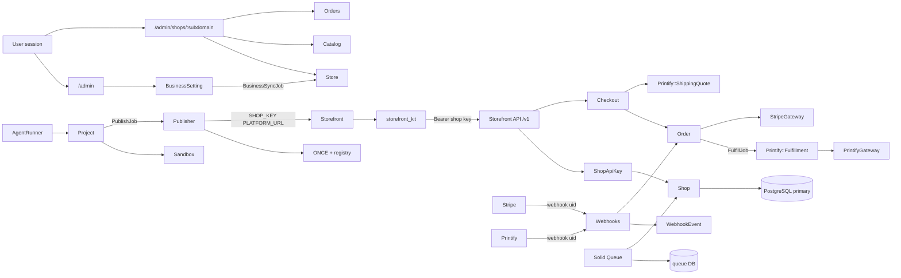

# 01 — System Inventory

Ngày khảo sát: 2026-10-22. Chỉ đọc mã. Không sửa ứng dụng.

Phạm vi đã chốt:

- Sản phẩm gồm **builder/agent và commerce platform** trong cùng một hệ thống.
- Đơn vị kinh doanh là **một chủ có nhiều shop**. Không có tầng Merchant, Subscription hay billing SaaS riêng.

Nhãn trạng thái:

| Nhãn | Nghĩa |
|---|---|
| VERIFIED | Có trong mã hoặc schema, và đường đi chính đã đọc |
| PARTIAL | Có một phần; thiếu so với vận hành thương mại hoặc so với `docs/platform-v1.md` |
| MISSING | Không có trong mã đã đọc |
| UNKNOWN | Chưa đủ bằng chứng (thường là vận hành production ngoài repo) |

`docs/platform-v1.md` (đề xuất 2026-10-15) và `docs/storefront-api.md` là tài liệu thiết kế. Inventory này lấy **mã và `builder/db/schema.rb`** làm hiện trạng. Lệch giữa hai bên nằm ở mục 6.

---

## 1. Hình dạng hệ thống

Một Rails monolith (`builder/`) giữ dữ liệu mọi shop và studio xây storefront. Mỗi shop là một app Rails không database (`storefront/` là template; bản đã sinh nằm ở `projects/`, ngoài git của repo này), gọi Platform qua HTTPS bằng shop key.

```
Chủ shop (User + session cookie)
  └── Shop  (nhiều shop qua shop_memberships)
        ├── Store            cài đặt, Stripe, Printify, pixel
        ├── Catalog          products, variants, collections, discounts, promotions
        ├── Commerce         carts, orders, line_items, reviews
        ├── Nội dung         pages, menus, forms, theme_settings
        ├── Project          storefront code, agent, preview, publish ONCE
        └── ShopApiKey       preview | storefront

Storefront (Rails, không DB)
  └── storefront_kit  →  GET/POST /v1  →  Platform
Stripe / Printify     →  POST /webhooks/:provider/:shop_uid
```

Không có Redis, không có microservice, không có Kubernetes, không có file Kamal (`deploy.yml` không có trong repo). Job, cache và cable dùng Solid trên PostgreSQL.

---

## 2. Bảng inventory

| Layer | Component | Implementation | Status | Evidence | Risk |
|---|---|---|---|---|---|
| Runtime | Ruby | 3.3.10 | VERIFIED | `builder/.ruby-version` | Thấp |
| Runtime | Rails | 8.1.4, `config.load_defaults 8.1` | VERIFIED | `builder/Gemfile`, `builder/config/application.rb` | Thấp |
| App shape | Modular monolith, một process web | Namespace `Admin`, `ShopAdmin`, `StorefrontApi::V1`, `Webhooks`, `Printify`, `Evaluation`. Không có `app/services`, không có engine, không có policy class | VERIFIED | `builder/config/routes.rb`, `builder/app/` | Logic dày nằm ở model (`Order`, `Store`, `Checkout`, `Project`) |
| Database | PostgreSQL, một database cho mọi shop và builder | `platform_development` / `platform_production`. Postgres 17 trong README local | VERIFIED | `builder/config/database.yml`, `README.md` | Platform là điểm sống còn của mọi shop |
| Database | Queue, cache, cable tách database | Solid Queue, Solid Cache, Solid Cable. Production: `platform_production_queue`, `_cache`, `_cable` | VERIFIED | `database.yml`, `queue.yml`, `cache.yml`, `cable.yml`, `production.rb` | Ba database phụ cùng server với primary, trừ khi vận hành tách |
| Tenancy | Shared schema, `shop_id` + `acts_as_tenant` | `require_tenant = true`. 24 model gọi `acts_as_tenant :shop` | VERIFIED | `config/initializers/acts_as_tenant.rb`, grep `acts_as_tenant` | RLS **MISSING**. Một `without_tenant` sai có thể đọc chéo shop |
| Ownership | Một user, nhiều shop | `Shop.open!` tạo membership `owner`. `shops` không có `owner_id` | VERIFIED | `Shop.open!`, `shop_memberships`, `Admin::ShopsController#create` | Đúng mô hình đã chốt |
| AuthN platform | Session cookie, bcrypt | `Authentication`, `Session`, `has_secure_password`. Cookie `httponly`, `same_site: :lax`, `permanent` | VERIFIED | `concerns/authentication.rb`, `User` | Session không hết hạn theo thời gian |
| AuthZ shop | Membership role | `owner`, `admin`, `staff`. `require_administrator` cho settings | VERIFIED | `ShopMembership`, `ShopAdmin::BaseController` | Không có audit log hành động admin ngoài `order_events` |
| AuthZ builder | User role | `member`, `admin`, `owner` của **builder**, khác role của shop | VERIFIED | `User` | Hai hệ role dễ nhầm khi vận hành |
| Giới hạn builder | Số app và ngân sách agent | `APPS_PER_ACCOUNT` mặc định 2, `MONTHLY_BUDGET_USD` mặc định 20. Admin không giới hạn | VERIFIED | `config/initializers/builder.rb`, `User#app_limit`, `Usage` | Đây là hạn mức agent, không phải subscription commerce |
| Storefront API | REST JSON `/v1` | Bearer shop key, ETag, lỗi `{ error: { code, message, fields } }`, tiền bằng cents | VERIFIED | `StorefrontApi::V1::BaseController`, `docs/storefront-api.md` | Contract đã có phiên bản `/v1`, chưa có `/v2` |
| API auth | Shop key | SHA-256 digest, prefix `sk_shop_` / `sk_preview_`, thu hồi bằng `revoked_at` | VERIFIED | `ShopApiKey` | Key preview và live là hai kind; plaintext chỉ hiện một lần |
| Rate limit | API và form | 600 req/phút/key. Form 10/phút. Order lookup 3/10 phút/email | VERIFIED | `BaseController`, `forms/submissions_controller.rb`, `order_lookups_controller.rb` | Rate limit của Rails lưu theo cache store. Production dùng Solid Cache |
| Idempotency | Đặt đơn và tạo payment | Header `Idempotency-Key`, unique `(shop_id, key)` | VERIFIED | `StorefrontApi::Idempotent`, bảng `api_idempotency_keys` | Không có job xóa key cũ trong `recurring.yml` dù doc nói giữ một ngày |
| Catalog | Product, variant, collection | Option 1–3, JSONB custom fields và buyer inputs, `printify_product_id` | VERIFIED | `products`, `variants`, `Product` | Không có bảng POD provider riêng |
| Giá | Cents trên variant, discount, promotion | `price_cents`, `compare_at_price_cents`, `cost_cents` | VERIFIED | `schema.rb`, `Discount`, `Promotion` | Promotion là sale theo phần trăm trên variant, không phải pricing engine |
| Tồn kho | Số lượng trên variant | `track_inventory`, `inventory_quantity` | PARTIAL | `variants` | POD thường không giữ kho thành phẩm. Chưa đánh giá chỗ trừ kho trong checkout ở phase này |
| Giỏ và checkout | `Cart`, `Checkout` (PORO) | Giá lấy từ DB. Đơn manual xóa giỏ ngay. Đơn thẻ giữ giỏ đến khi Stripe xác nhận | VERIFIED | `Checkout`, `Cart` | Không có bảng checkout riêng. Trạng thái checkout nằm trên `orders.status = pending` |
| Đơn | State machine trên `Order` | `pending → paid → in_production → shipped → delivered`; `cancelled`, `refunded` | VERIFIED | `Order::STATUSES`, các method `mark_paid!`, `ship!`, … | Chuyển trạng thái trong model, không có gem state machine |
| Thanh toán | Stripe Payment Element + manual | `StripeGateway`. Không lưu số thẻ. PaymentIntent trên Platform | VERIFIED | `StripeGateway`, `orders.stripe_payment_intent_id` | Một shop một tài khoản Stripe (key trên `stores`) |
| Thuế | Stripe Tax, tùy chọn | `stores.stripe_tax`, `orders.tax_cents`, `stripe_tax_calculation_id` | PARTIAL | `schema.rb`, `StripeGateway#tax_calculation` | Chỉ khi shop bật Stripe Tax |
| POD | Printify | `PrintifyGateway`, `Printify::Import`, `Printify::ShippingQuote`, `Printify::Fulfillment` | VERIFIED | `builder/app/models/printify*` | Printful và Gelato **MISSING**. Không có adapter contract |
| Cá nhân hóa | Buyer inputs | JSONB trên product và line item. Đơn có text không tự gửi Printify | VERIFIED | `Printify::Fulfillment#needs_personalizing?`, `platform-v1.md` §5 | Đơn in chữ chờ người vận hành |
| Webhook | Stripe và Printify theo shop uid | Chữ ký kiểm tra. `WebhookEvent` unique `(shop_id, provider, event_id)` | VERIFIED | `Webhooks::*`, `WebhookEvent.handle` | Shop dùng chung tài khoản Stripe/Printify: event không khớp đơn thì `ignored` |
| Khách mua | `customers` | `has_secure_password`, unique `(shop_id, email_address)` | PARTIAL | `Customer`, schema | Không có route đăng ký/đăng nhập khách. `Checkout` không gán customer. Bảng chưa đi vào luồng mua |
| Tìm đơn | Order lookup bằng email | API `order_lookups`, storefront `/orders/find` | VERIFIED | routes cả hai app, `OrderLookup` | Khách không có tài khoản |
| Nội dung | Pages, FAQ, menus, forms, policies | JSONB `faqs`, `items`, `fields`. Policy là cột text trên `stores` | VERIFIED | schema, `shop_admin` routes | Đủ cho storefront v1 |
| Theme | Schema từ storefront, giá trị trên Platform | `theme_settings` unique theo shop. Ảnh qua Active Storage | VERIFIED | `ThemeSetting`, `Publisher#apply_theme_files` | Đổi key trong YAML làm mất giá trị cũ (đã ghi trong template `CLAUDE.md`) |
| Admin chủ | `/admin` | Dashboard, settings (business), users, tạo shop | VERIFIED | `routes.rb` namespace `:admin` | Settings chủ copy sang shop qua `BusinessSync`, không phải nguồn sự thật lúc bán |
| Admin shop | `/admin/shops/:subdomain` | Sản phẩm, đơn, Printify, Stripe, nội dung, key, thành viên | VERIFIED | `routes.rb` scope `shop_admin` | Tenant lấy từ membership của user đăng nhập, không tin shop id từ client một mình |
| Builder | Project, agent, preview, publish, eval | `Project`, `AgentRunner`, `AgentTurnJob`, `Sandbox`, `Publisher`, `Evaluation::*` | VERIFIED | `builder/app/models/project.rb`, `agent_runner.rb`, `publisher.rb` | Agent và commerce cùng DB và cùng app |
| Agent sandbox | Docker mặc định, local khi test | Container theo project, CPU/RAM cấu hình được | VERIFIED | `Sandbox`, `config/initializers/builder.rb` | `SANDBOX=local` cho agent quyền trên máy chủ |
| Publish | ONCE | Build image, push registry, `once deploy` / `once backup` rồi `once update` | VERIFIED | `Publisher`, `README.md` | Không có pipeline CD trong repo ngoài CI test |
| Storefront | Rails 8.1, Hotwire, Tailwind, không DB | Template `storefront/`. Render HTML server-side | VERIFIED | `storefront/Gemfile`, `storefront/config/routes.rb` | Mỗi shop một app. Không có SPA dùng chung |
| API client | `storefront_kit` | `Api`, records, cache đọc catalog `fresh_for` 30 giây | VERIFIED | `blocks/storefront_kit/lib/storefront_kit/api.rb` | Storefront không đụng schema Platform |
| Ảnh | Active Storage + libvips | `Product` images, `ThemeSetting` images. Production `service = :local` | PARTIAL | `storage.yml` (S3 comment), `production.rb` | Disk local không phải R2/CDN như thiết kế |
| Email | Action Mailer | `OrderMailer`, `InvitationsMailer`, `Admin::FormMailer` | PARTIAL | `builder/app/mailers/` | Production `default_url_options` host `example.com`. SMTP đang comment |
| Tìm kiếm | `ILIKE` trên title / email / tên | `Product.search`, `Order.search` | PARTIAL | các scope đó | `pg_search` trong thiết kế **MISSING** |
| Bảo mật phụ | CSP, lọc log, mã hóa cột | CSP đang comment. Filter `passw`, `secret`, `token`, `_key`. `encrypts` trên secret | PARTIAL | `content_security_policy.rb`, `filter_parameter_logging.rb`, `active_record_encryption.rb` | Đổi `secret_key_base` làm không đọc được secret đã mã hóa |
| CI | GitHub Actions | Brakeman, bundler-audit, importmap audit, RuboCop, test | VERIFIED | `builder/.github/workflows/ci.yml`, `storefront/.github/workflows/ci.yml` | Redis trong workflow bị comment, khớp với không dùng Redis |
| Observability | Log STDOUT + request id | `config.log_tags = [:request_id]`, health `/up` | PARTIAL | `production.rb` | Không có metrics, trace, error tracker trong repo |
| Backup | Backup storefront trước update ONCE | `Publisher#deploy_steps` gọi `once backup` | PARTIAL | `Publisher` | Backup Postgres của Platform **MISSING** trong repo |
| Hạ tầng as code | Dockerfile | `builder/Dockerfile` (ghi Kamal hoặc chạy tay), `storefront/Dockerfile` (ONCE), `builder/sandbox/Dockerfile` | PARTIAL | các Dockerfile | Không có Compose cho cả platform, không có `deploy.yml` |

---

## 3. Bản đồ phụ thuộc



Chiều phụ thuộc commerce: storefront không import model Platform. Platform không render trang mua. Printify và Stripe đi qua `PrintifyGateway` và `StripeGateway`, nhưng các class đó là client của **một** nhà cung cấp, chưa phải cổng nhiều provider.

Job mang tenant: `ApplicationJob#serialize` ghi `shop_id`, `perform_now` bọc `ActsAsTenant.with_tenant`. Job định kỳ đi qua `Shop.each_in_turn` (`Promotion::SyncJob`, `Order::ExpireUnpaidCardJob`, `Order::TrackShipmentsJob`, `Order::RequestReviewsJob`, `Cart::CleanupJob` trong `config/recurring.yml`).

---

## 4. Sở hữu dữ liệu

38 `create_table` trong `builder/db/schema.rb` (version `2026_10_16_110000`).

### 4.1 Theo chủ tài khoản, không theo shop

| Bảng | Chủ | Ghi chú |
|---|---|---|
| `users` | Tài khoản platform | Role builder: member, admin, owner |
| `sessions` | User | |
| `business_settings` | User, unique | Secret Stripe/Printify/pixel cấp chủ. Copy sang shop |
| `usages` | User, tùy chọn project | Chi phí agent USD, không phải doanh thu shop |
| `projects` | `owner_id`, `shop_id` nullable | Một project một shop khi đã gắn |
| `messages`, `agent_commands`, `deployments` | Project | |

### 4.2 Theo shop

Mọi bảng commerce và nội dung có `shop_id` not null, foreign key tới `shops`, và model `acts_as_tenant :shop`:

`stores`, `shop_memberships`, `shop_api_keys`, `products`, `variants`, `collections`, `collection_products`, `custom_field_definitions`, `discounts`, `promotions`, `promotion_items`, `carts`, `cart_items`, `orders`, `line_items`, `order_events`, `customers`, `product_reviews`, `pages`, `menus`, `forms`, `form_submissions`, `theme_settings`, `platform_requests`, `webhook_events`, `api_idempotency_keys`.

`stores.shop_id` unique: một shop một hàng cài đặt. Secret trên `stores` được `encrypts`. Đây là cấu hình dùng lúc bán. `business_settings` là bản chủ để `BusinessSync` đẩy xuống shop.

### 4.3 Không thuộc shop

`active_storage_*` gắn record đa hình (`record_type`, `record_id`), không có `shop_id`. Ảnh product và theme đi theo record đã có shop. Blob không tự cô lập theo tenant ở tầng bảng.

### 4.4 Ràng buộc đáng chú ý

- Unique kèm shop: slug sản phẩm và collection, mã giảm giá (lower code), email khách, số đơn, key form/menu/custom field, API idempotency, webhook event.
- Unique toàn cục, cố ý: `carts.token`, `orders.token`, `orders.stripe_payment_intent_id`, `shops.uid`, `shops.subdomain`, `shop_api_keys.token_digest`.
- `projects.shop_id` được phép null. `Shop#purge!` gỡ shop chưa có đơn và tách project.
- Không có bảng domain tùy chỉnh, subscription, invoice, provider connection, artwork, mockup, shipment riêng (tracking nằm cột trên `orders`).
- Extension Postgres chỉ `plpgsql`. Không có RLS policy trong schema.

---

## 5. Luồng đã có trong mã

Các luồng này **tồn tại**. Mức đúng đắn khi lỗi và khi nhiều shop sẽ là việc của phase audit, không kết luận ở đây.

| Luồng | Đi qua | Bằng chứng |
|---|---|---|
| Mở shop | `Admin::ShopsController#create` → `Shop.open!` → `BusinessSyncJob` nếu chủ đã có business setting | controller, `Shop.open!` |
| Gọi API | Bearer token → `ShopApiKey.authenticate` → `set_current_tenant` | `StorefrontApi::V1::BaseController` |
| Vào admin shop | Cookie session → membership theo subdomain → `set_current_tenant` | `ShopAdmin::BaseController#set_shop` |
| Đặt đơn | `POST /v1/checkouts` → `Checkout#place` → `Order` | `Checkout`, routes |
| Trả thẻ | `POST /v1/orders/:token/payment` → PaymentIntent. Webhook `payment_intent.succeeded` xác nhận | `StripeGateway`, `Webhooks::StripeController` |
| Gửi in | Sau khi paid, `Order#fulfill_later` → `Order::FulfillJob` → `Printify::Fulfillment#submit!` | `Order#fulfill_later` |
| Đồng bộ vận chuyển | Webhook Printify hoặc `Order::TrackShipmentsJob` mỗi giờ → `Fulfillment#sync!` | `recurring.yml`, `Webhooks::PrintifyController` |
| Publish | `PublishJob` → `Publisher#publish` → Docker image → ONCE | `Publisher` |
| Agent | `AgentTurnJob` → `AgentRunner` trong sandbox | `AgentTurnJob`, `AgentRunner` |

Đơn test (`orders.test`, key preview) không gửi Printify, không báo Meta, không tính vào sales (`Order.real`).

---

## 6. Lệch giữa `docs/platform-v1.md` và mã

| Thiết kế | Mã hiện tại | Nhãn |
|---|---|---|
| `shop_id` + `acts_as_tenant`, RLS sau | Tenancy app đã bật. RLS chưa có | VERIFIED / MISSING |
| `pg_search` | `Product.search` là `ILIKE` title | MISSING |
| Ảnh S3/R2 + CDN | Active Storage local trong production | PARTIAL |
| Stripe và Printify trên business setting của chủ, shop ghi đè | Cả `business_settings` và `stores` đều có key. Lúc bán đọc `Store` | VERIFIED, hai nơi |
| Webhook `/webhooks/stripe/:uid` và Printify, bảng `webhook_events` | Khớp | VERIFIED |
| Storefront API bảng mục 6 của platform-v1 | Routes `/v1` khớp danh sách endpoint đã đối chiếu với `routes.rb` | VERIFIED |
| Khách không cần tài khoản. Tài khoản khách tùy chọn, chưa có mật khẩu trong doc mục 8 | Bảng `customers` có `password_digest` not null và model `has_secure_password`, nhưng không có luồng tạo tài khoản | PARTIAL |
| Hạ tầng: Platform server riêng, Kamal, Postgres backup, giám sát | Dockerfile nhắc Kamal. Không có `deploy.yml`, không có job backup DB, mailer host mẫu | PARTIAL / UNKNOWN ngoài repo |
| Printify là provider duy nhất trong doc | Đúng với mã. Printful/Gelato không có | VERIFIED |
| Booking đã bỏ | Không thấy model booking | VERIFIED |

---

## 7. Chưa có, so với đích thương mại đã chốt

Đích đã chốt là một chủ nhiều shop, cộng builder. Những mục dưới **không** được giả định là đã xây.

| Hạng mục | Nhãn |
|---|---|
| Printful, Gelato, adapter POD chung | MISSING |
| Domain riêng ngoài subdomain ONCE | MISSING |
| Subscription, invoice, usage commerce | MISSING. `usages` chỉ là chi phí agent |
| Đăng nhập khách mua | MISSING trong luồng. Bảng thì có |
| Artwork, mockup, print area như thực thể riêng | MISSING. Ảnh sản phẩm là Active Storage. Text in là `buyer_inputs` |
| Shipment nhiều kiện như bảng riêng | PARTIAL. Một `carrier` / `tracking_number` trên `orders`. Fulfillment Printify biết tách kiện trong sync |
| Redis | MISSING, và không cần cho hiện trạng |
| Search engine riêng | MISSING |
| Metrics, tracing, error tracking, backup Postgres, runbook | MISSING trong repo |

---

## 8. Unknown còn lại

Những mục này không kết luận từ mã.

1. Platform và ONCE đã chạy trên server thật chưa, hay mới máy local như `README.md` ("early, runs on one machine" cho builder; mục publish "Before other people use it").
2. Registry, `PUBLISH_DOMAIN`, `BACKUPS_ROOT` production trỏ đâu.
3. Postgres có backup và diễn tập khôi phục ngoài repo không.
4. Email giao dịch (đơn, lời mời) đang gửi bằng adapter nào khi SMTP trong `production.rb` đang tắt.
5. `SECRET_KEY_BASE` production được giữ thế nào. Đổi key làm mất secret mã hóa (`active_record_encryption.rb`).
6. Số shop, đơn và kích thước ảnh hiện có trên database development không được đo trong phase này.
7. `projects/` chứa storefront sinh ra. Không audit từng app đó.

---

## 9. Kết phase 1

### Đã xác minh

- Hệ thống là monolith Rails 8.1 trên PostgreSQL, headless theo nghĩa storefront không giữ dữ liệu bán.
- Một chủ nhiều shop đã có: `users` → `shop_memberships` → `shops`, kèm project/storefront riêng.
- Commerce một provider: catalog, giỏ, checkout, Stripe, Printify, webhook, idempotency, tenant theo request.
- Builder/agent, sandbox Docker, preview và publish ONCE nằm cùng app và cùng database với commerce.

### Rủi ro cần mang sang phase audit

- Cô lập tenant ở tầng ứng dụng, chưa có RLS. Blob Active Storage không có `shop_id`.
- Secret thanh toán và POD nằm trên `stores`, mã hóa bằng khóa suy ra từ `secret_key_base`, file lưu local ở cấu hình production.
- Không có backup Postgres, SMTP, CDN hay giám sát trong repo.
- POD và thanh toán không có lớp provider. Thêm nhà in thứ hai sẽ đụng `Order`, `Store`, `Checkout` và webhook.
- Đơn có chữ in không tự fulfill. Đây là hành vi đã chọn, nhưng là việc vận hành tay.

### Khuyến nghị trước khi thiết kế lại

Giữ modular monolith và shared schema. Đừng thêm Redis, Kafka hay service riêng ở bước kế. Phase audit nên đọc kỹ `Checkout#place`, chuyển trạng thái `Order`, `Printify::Fulfillment`, và mọi chỗ `ActsAsTenant.without_tenant` trước khi đề xuất đổi ranh giới module.

### Cần duyệt trước phase 2

Phase 2 viết audit kiến trúc hiện tại và sổ nợ kỹ thuật (`02_CURRENT_ARCHITECTURE_AUDIT.md`, `03_ARCHITECTURAL_DEBT_REGISTER.md`). Vẫn không sửa mã ứng dụng.
