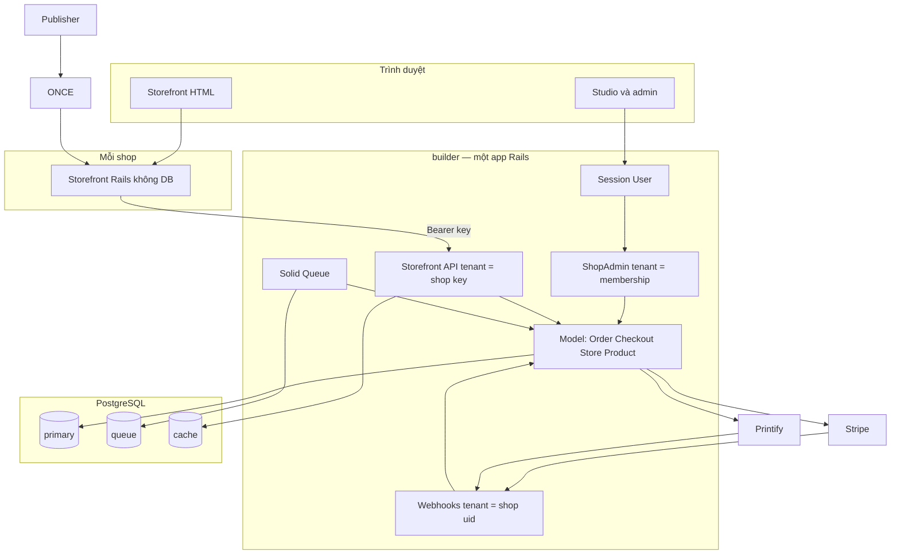
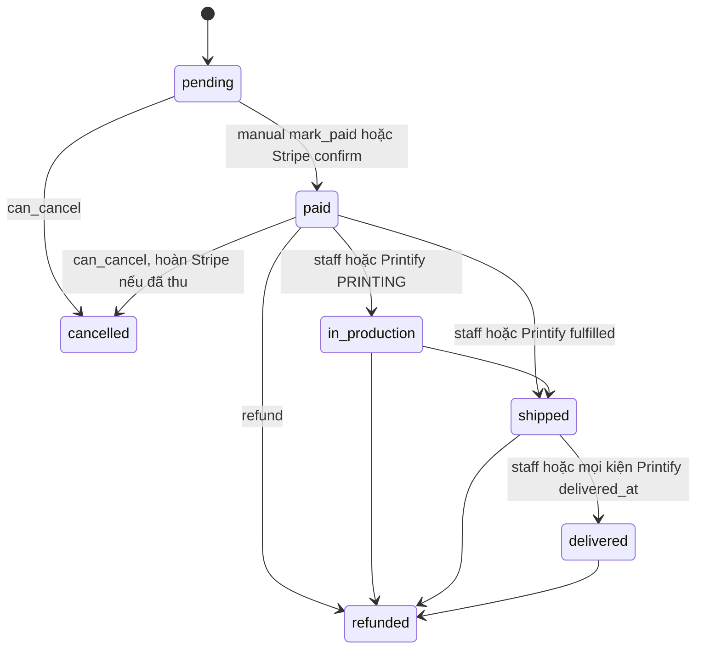

# 02 — Current Architecture Audit

Ngày: 2026-10-22. Tiếp tục từ `01_SYSTEM_INVENTORY.md`. Chỉ đọc mã. Không sửa ứng dụng.

Phạm vi đã chốt: builder/agent và commerce trong một hệ thống; một chủ có nhiều shop.

Nhãn: **VERIFIED**, **PARTIAL**, **MISSING**, **UNKNOWN**, **RECOMMENDATION**.

---

## 1. Kết luận ngắn

Hiện trạng là **monolith Rails có namespace**, cộng một app storefront không database. Chưa phải modular monolith có ranh giới được kiểm tra, và chưa phải microservices.

Commerce chạy được cho một chủ, nhiều shop, một Printify, một Stripe mỗi shop. Ranh giới headless giữa storefront và Platform là thật. Ranh giới giữa đơn hàng và Printify thì không: `Order` gọi thẳng fulfillment Printify.

Cô lập shop bằng `acts_as_tenant` là có chủ đích và các chỗ `without_tenant` trong mã production đã đọc đều để tìm shop rồi vào lại tenant. Chưa thấy lỗ hổng đọc chéo shop trên các đường đó. Database chưa chặn hộ ứng dụng.

Điểm yếu nằm ở giao dịch nhiều hệ thống (Stripe, Printify, Postgres), ở việc một bộ secret của chủ ghi đè secret từng shop, và ở vận hành production chưa có trong repo.

---

## 2. Sơ đồ hiện trạng



Storefront không mở Postgres của Platform. Agent sửa code storefront trong sandbox, không sửa model commerce.

---

## 3. B1 — Kiến trúc ứng dụng

**Phân loại: monolith có namespace, headless ở biên storefront. VERIFIED.**

| Khối | Nằm ở | Phụ thuộc ra ngoài khối |
|---|---|---|
| Studio / agent | `Project`, `AgentRunner`, `Sandbox`, jobs `AgentTurnJob`, `PublishJob` | Tạo `Shop`, ghi `ShopApiKey`, `DemoCatalog` (`Project#ensure_shop!`) |
| Admin chủ | `Admin::*` | `BusinessSetting` → `BusinessSyncJob` → `Store` của mọi shop owner/admin |
| Admin shop | `ShopAdmin::*` | Model commerce của tenant hiện tại |
| API bán | `StorefrontApi::V1::*` | `Checkout`, `Cart`, `Order`, `StorefrontApi::Json` |
| Thanh toán | `StripeGateway`, cột trên `Order` và `Store` | Stripe HTTP |
| In | `PrintifyGateway`, `Printify::*` | `Order` gọi vào và bị gọi lại |
| Storefront | app `storefront/` + `storefront_kit` | Chỉ HTTP `/v1` |

Không có `app/services`, không có engine, không có Packwerk. `builder/lib` không có file Ruby. Logic nghiệp vụ nằm trong `app/models`, kể cả thứ không phải bản ghi: `Checkout`, `StripeGateway`, `PrintifyGateway`, `Printify::Fulfillment`, `Publisher`, `AgentRunner`.

**Chiều phụ thuộc.** Storefront → API → model. Chiều này sạch. **VERIFIED** (`storefront/Gemfile` không có `pg`; `storefront_kit` chỉ có HTTP client).

`Order` phụ thuộc `Printify::Fulfillment`, `StripeGateway`, `Meta::Purchase`, `OrderMailer`. **VERIFIED** (`order.rb`: `fulfill_later`, `refund_in_stripe`, `report_purchase_later`). Catalog không import controller. Chưa thấy vòng require giữa file, nhưng có vòng gọi lúc chạy: `Order#cancel!` → `Printify::Fulfillment#cancel!` → `Order#record`.

**Ranh giới transaction.** Một transaction Postgres không bao Stripe hay Printify. Các PORO tự mở `transaction` / `with_lock`. Không có outbox.

**RECOMMENDATION.** Giữ một app. Lần chỉnh tiếp theo nên nhóm theo thư mục namespace (`Commerce`, `Printify`, `Billing` của shop, `Studio`) mà chưa tách process. Chưa đủ lý do để tách service.

---

## 4. B2 — Kiến trúc Rails

### Model dày, controller mỏng

Controller shop admin và API chủ yếu tìm bản ghi, gọi một method, render. Ví dụ `ShopAdmin::OrdersController#update` chỉ `update` và `record`. `StorefrontApi::V1::CheckoutsController` gọi `Checkout#place`.

Model và PORO giữ quy tắc. `Order` khoảng 320 dòng, gồm trạng thái, Stripe, thuế, tồn kho trả lại, và kích hoạt Printify. `Product#sync_variants` chạy `after_save` và tạo/xóa variant. `Checkout` là form object đúng chỗ, không kế thừa Active Record.

**VERIFIED.** Đây là kiểu Rails tập trung quy tắc vào model, chưa có service object đều nhau. Với đội nhỏ, `Checkout` và `Printify::Fulfillment` là mẫu nên giữ. `Order` đang ôm thêm tích hợp.

### Callback

Callback đang làm việc có chủ đích, không phải chỗ giấu nghiệp vụ đơn hàng:

- `Product` `after_save :sync_variants` — sinh tổ hợp option.
- `Order` `before_create :assign_number`.
- `FormSubmission` `after_create_commit :notify_shop`.
- `Project` broadcast sau commit.

Chuyển trạng thái đơn đi qua `Order#transition!`, không qua callback. **VERIFIED.**

### Transaction và khóa

`Variant#take_stock` trừ kho bằng một `update_all` có điều kiện `inventory_quantity >= quantity`. `Discount#redeem!` tăng `times_used` cùng kiểu. Cả hai nằm trong transaction của `Checkout#place`. Hai checkout không cùng lấy chiếc cuối nếu `track_inventory` bật. **VERIFIED** (`checkout.rb` `take_stock_and_discount`, `variant.rb` `take_stock`).

`Order#transition!` `lock!` rồi kiểm tra predicate. Hai xác nhận thẻ cùng lúc: một cái thắng, cái kia `InvalidTransition` và `confirm_card_payment!` trả `false`. **VERIFIED.**

`assign_number` lấy `maximum + 1`, unique `(shop_id, number)`, `Checkout#with_number_retry` thử lại 3 lần. **VERIFIED.**

### Job

`ApplicationJob` ghi `shop_id` khi serialize và bọc `perform_now` bằng `ActsAsTenant.with_tenant`. Job định kỳ không có `shop_id` và gọi `Shop.each_in_turn`. **VERIFIED** (`application_job.rb`, `order/track_shipments_job.rb`).

`retry_on ActiveRecord::Deadlocked` đang bị comment. `Order::FulfillJob` coi là thành công cả khi Printify lỗi, vì `submit!` nuốt `PrintifyGateway::Error` và ghi `fulfillment_error`. Hàng đợi không thấy job thất bại. **VERIFIED.**

### Injection và lỗi

Không có dependency injection framework. Test thay `StripeGateway.build` và `PrintifyGateway.build` bằng fake (ghi trong comment hai class). Lỗi tích hợp là `StripeGateway::Error` và `PrintifyGateway::Error`. API map lỗi field qua `invalid`. Chưa có lớp lỗi chung cho saga.

**RECOMMENDATION.** Không đưa thêm framework DI. Khi tách provider, một PORO `Fulfillment` gọi cổng, `Order` chỉ giữ trạng thái và gọi cổng qua một method.

---

## 5. B3 — Commerce

### Đặt hàng

`Checkout#place` (`checkout.rb`):

1. Validate địa chỉ, quốc gia shop ship, buyer inputs, phương thức thanh toán.
2. Copy giá và title từ variant vào line item. Giá không lấy từ form.
3. Trong một transaction: trừ kho, redeem mã, `save!` đơn, ghi event `placed`. Đơn manual xóa giỏ. Đơn thẻ giữ giỏ.
4. Sau commit, đơn manual mới gửi email và Meta. Đơn thẻ chờ `confirm_card_payment!`.

Thuế không nằm trong `Checkout#total_cents`. Thuế Stripe được cộng trong `Order#card_payment!`, lúc tạo PaymentIntent, và sửa `total_cents`. **VERIFIED.** Đơn manual giữ `tax_cents` mặc định 0.

Phí ship Printify: `Printify::ShippingQuote`, cache 30 phút. Khi Printify không báo giá, checkout dùng giá flat của shop và vẫn đặt đơn (`Checkout#shipping_cents`). **VERIFIED.** Shop có thể thu ít hơn chi phí ship thật.

`customer:` trên checkout không được API gán (`checkouts_controller.rb` chỉ permit địa chỉ và attribution). Cột `orders.customer_id` không đi vào luồng mua. **VERIFIED.**

Idempotency nằm ở controller (`StorefrontApi::Idempotent`), không nằm trong `Checkout`. Không có header thì hai POST tạo hai đơn. **VERIFIED.**

### Máy trạng thái đơn



Predicate trong `Order`: `can_mark_paid?`, `can_start_production?`, `can_ship?`, `can_mark_delivered?`, `can_cancel?` (pending hoặc paid), `can_refund?` (mọi trạng thái đã paid). Không có bảng chuyển riêng. **VERIFIED.**

`cancelled_by_printify!` không chuyển đơn sang `cancelled` và không hoàn tiền. Chỉ ghi `fulfillment_error`. **VERIFIED** (`printify/fulfillment.rb`).

Đơn vừa có hàng Printify vừa có hàng shop: khi Printify giao phần của nó, hệ thống ghi event `printify_shipped` và không gọi `ship!`. Nhân viên tự giao phần còn lại. Nhiều kiện Printify gộp thành một `tracking_number` nối bằng dấu phẩy. **VERIFIED** (`own_items?`, `ship`).

### Thanh toán

Số thẻ không vào Platform (`StripeGateway` comment và `create_payment_intent`). Webhook kiểm chữ ký, dedupe bằng `WebhookEvent`. **VERIFIED.**

`cancel!` và `refund!` gọi Stripe **trước** transaction cục bộ, rồi mới `transition!`. Printify `cancel!` chạy **sau** transaction. Nếu Stripe đã hoàn mà transaction lỗi, tiền đã về khách trong khi đơn chưa đổi. Nếu đơn đã hủy mà Printify từ chối hủy, đơn local đã refund và Printify có thể vẫn in. Lỗi Printify được ghi `fulfillment_failed`, không hoàn tác refund. **VERIFIED.**

### Tồn kho, giảm giá, khuyến mãi

Kho là cờ trên variant. Sản phẩm Printify import có thể không track. Promotion đổi giá variant theo lịch (`Promotion::SyncJob` mỗi 5 phút), không phải một lớp giá theo shop/market.

### Hoàn, trả, vận chuyển

Refund một phần từ dashboard Stripe chỉ ghi `refunded_cents` và timeline (`record_partial_refund!`), không đổi status. Hàng đã ship không tự nhập kho; `return_to_stock!` là thao tác nhân viên. Không có bảng return hay shipment. **PARTIAL.**

Sửa địa chỉ đơn (`ShopAdmin::OrdersController#update`) ghi event `edited` và không gọi Printify. **VERIFIED.**

---

## 6. B4 — Headless

| Câu hỏi | Kết quả | Bằng chứng |
|---|---|---|
| Storefront có đụng bảng Platform không | Không | `storefront/Gemfile`, không Active Record data |
| Contract | REST `/v1`, cents, ETag, lỗi có code | `StorefrontApi::V1::BaseController` |
| Auth | Bearer shop key, kind preview hoặc storefront | `ShopApiKey` |
| Phân trang | Catalog có page | `storefront_kit` `Api#products` |
| Cache | ETag HTTP và cache đọc catalog 30 giây trong kit. Quote ship cache 30 phút trên Platform | `api.rb`, `shipping_quote.rb` |
| Rate limit | 600/phút/key | `BaseController` |
| Version | Chỉ `/v1` | `routes.rb` |
| Key có ra browser không | Storefront gọi từ server. Key là env `SHOP_KEY` | `Project#storefront_env` |

Storefront vẫn biết khái niệm commerce (cart, checkout, Payment Element) nhưng lấy schema từ JSON, không từ cột database. `StorefrontApi::Json` là chỗ shape JSON được lắp. **VERIFIED.**

Điểm dính có chủ đích: lúc publish, Platform đọc `theme_settings.yml` và `forms.yml` của storefront (`Publisher`). Agent không tạo bảng.

**RECOMMENDATION.** Giữ storefront Rails server-side để shop key không vào trình duyệt. Một storefront JavaScript gọi thẳng `/v1` từ browser sẽ đổi mô hình bí mật của key.

---

## 7. B5 — SaaS nhiều shop

### Sở hữu

```
User (tài khoản đăng nhập studio)
  ├── business_settings     một bộ Stripe / Printify / pixel
  ├── usages                tiền agent
  └── shop_memberships
        └── Shop
              ├── stores              secret dùng lúc bán, unique 1-1
              ├── catalog, orders, customers
              └── project             0 hoặc 1 storefront
```

`Admin::ShopsController#create` mở shop cho user hiện tại và không tạo project. `Project#ensure_shop!` mở shop khi có app và gắn project. Hai cửa vào. **VERIFIED.**

Giới hạn `APPS_PER_ACCOUNT` (mặc định 2) chặn member tạo project, không chặn tạo shop trong admin. Builder `admin`/`owner` không bị hạn mức này. **VERIFIED** (`User#app_limit`).

### Ai được thấy gì

| Cửa | Cách chọn shop | Ai vào |
|---|---|---|
| `/admin/shops/:subdomain` | Membership của `Current.user`. Shop người khác thành 404 | owner, admin, staff của shop |
| Settings, Stripe, Printify, key, nội dung | `require_administrator` | owner và admin shop |
| Thành viên | `require_owner` | owner shop |
| `/v1` | Shop của API key | Đúng key chưa revoke |
| Webhook | `Shop.find_by(uid:)` rồi set tenant | Request có chữ ký đúng |
| Studio project | `User#accessible_projects`: member thấy project của mình, builder admin/owner thấy mọi project | Role **builder**, khác role shop |

Hai hệ role cùng tồn tại. **VERIFIED** (`User` enum và `ShopMembership::ROLES`).

Builder administrator mở được mã storefront của mọi project. Dữ liệu đơn trong admin shop vẫn theo membership. Key shop nằm mã hóa trên `projects.preview_shop_key` và `live_shop_key`. **PARTIAL** về mức phơi key trong UI: cột được `encrypts`, chưa đọc view download ở phase này.

### Đồng bộ secret chủ → mọi shop

`Admin::SettingsController#update` lưu `BusinessSetting` của user rồi `BusinessSyncJob` cho mọi shop user là owner hoặc admin (`shops` scope). `BusinessSync` ghi Stripe, Printify và pixel lên `Store` của từng shop. **VERIFIED.**

Hệ quả: shop đã nối một tài khoản Stripe khác sẽ bị bộ của chủ ghi đè ở lần lưu settings chủ kế tiếp. Nhiều shop dùng chung một Printify shop thì khớp `external_id` dạng `uid-sốđơn` trong `Printify::Fulfillment#external_id`. Nhiều tài khoản Printify khác nhau theo shop thì không sống được sau lần sync đó.

### Tenant context

Không có tenant id do browser gửi rồi dùng trực tiếp làm scope. API lấy shop từ hash key. Admin lấy shop từ membership khớp subdomain. Webhook lấy shop từ `uid` trên URL rồi mới đọc đơn trong tenant đó. `order_for` của Stripe còn đòi `metadata.shop == store.uid` khi tìm theo id đơn. **VERIFIED.**

### `without_tenant` trong mã production

| Chỗ | Việc | Rồi có vào tenant không |
|---|---|---|
| `ShopApiKey.authenticate` | Tìm key toàn cục theo digest | Có, controller `set_current_tenant` |
| `StorefrontApi::V1::BaseController` | Lấy `api_key.shop` | Có |
| `Webhooks::BaseController` | `Shop.find_by(uid:)` | Có |
| `ApplicationJob#perform_now` | Tìm shop theo id đã serialize | Có, `with_tenant` quanh `super` |
| `Shop.each_in_turn` | Liệt kê shop | Có, từng shop một |
| `Shop#purge!` | Xóa shop không có đơn | Cố ý xóa theo `shop_id` |
| `Project#shop_subdomain` | Tránh trùng subdomain | Chỉ `exists?` subdomain |
| `Project` before_destroy | Gỡ `project_id` trên platform request | `update_all` theo association của project |

Không thấy `without_tenant` nào trả danh sách đơn hoặc sản phẩm ra ngoài shop. **VERIFIED** trên các file app đã grep. Test dùng `without_tenant` thêm, không tính là đường production.

RLS vẫn **MISSING**. Một query mới quên set tenant sẽ nổ vì `require_tenant` (tốt) trừ khi tác giả bọc `without_tenant`.

### Những gì SaaS đích chưa có

Domain riêng, gói thuê bao commerce, hạn mức đơn, audit log admin ngoài `order_events`, cổng thanh toán thứ hai, nhà in thứ hai. **MISSING.** Phù hợp giai đoạn một chủ nhiều shop. Không phải lỗ của luồng đang chạy, mà là biên sản phẩm.

---

## 8. Printify trong kiến trúc hiện tại

`Printify::Fulfillment` là quy trình đơn nhà in, không phải cổng.

| Bước | Hành vi trong mã |
|---|---|
| Sau khi paid | `Order#fulfill_later` xếp `Order::FulfillJob` nếu shop đã nối Printify và đơn không test |
| `submit!` | Bỏ qua nếu có `properties` (chữ khách gõ), trừ khi staff gọi `personalized: false` |
| Tạo đơn | `external_id = uid-number`. Trùng thì tìm trong 3 trang đơn Printify |
| Lỗi | Ghi `orders.fulfillment_error`, job vẫn xong |
| Thử lại | Staff `ShopAdmin::Orders::FulfillmentsController`. Không có job quét đơn paid chưa có `printify_order_id` |
| Theo dõi | Webhook cộng `Order::TrackShipmentsJob` mỗi giờ, chỉ đơn đã có `printify_order_id` |
| Hủy phía Printify | Không tự hủy đơn local, không tự refund |

Đơn không biến mất khi Printify lỗi. **VERIFIED.** Đơn có thể nằm `paid` với `fulfillment_error` cho đến khi người vào admin.

---

## 9. Khuyến nghị giữ cho phase sau

1. Giữ shared schema và `acts_as_tenant`. RLS là lớp sau, không phải việc đầu.
2. Giữ storefront không database và API `/v1`.
3. Coi `Order` + Stripe + Printify là một saga có lỗ hổng bù trừ, ưu tiên trước khi thêm nhà in.
4. Chốt một quy tắc secret: hoặc một tài khoản chủ áp xuống mọi shop, hoặc secret từng shop là nguồn sự thật và màn `/admin/settings` không ghi đè. Hiện mã làm cả hai và lần lưu chủ thắng.
5. Chưa tách service, chưa thêm Redis.

Phase 3 (mô hình domain) chỉ nên vẽ ranh giới bên trong app này, theo đúng hai quyết định đã chốt.
