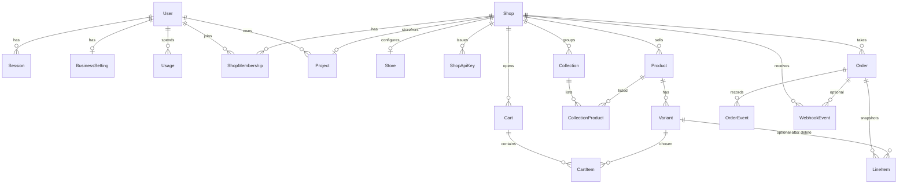

# 04 — Domain Model

Ngày: 2026-10-22. Mô hình của hệ thống đang chạy, theo hai quyết định đã chốt: builder/agent nằm cùng commerce, và một chủ có nhiều shop. Không thêm nhà in, không thêm bảng. Nguồn sự thật là schema và mã đã ghi trong `01` và `02`.

Thực thể dưới đây là thứ có trong database hoặc là đối tượng trong mã (PORO). Thứ prompt gốc nêu mà không có thực thể được ghi **không có**.

---

## 1. Bản đồ sở hữu

`Customer` có bảng và quan hệ tới `Order`, nhưng checkout không tạo customer. Quan hệ đó tồn tại trên schema và không tham gia luồng mua.

---

## 2. Identity

**Trách nhiệm.** Ai đăng nhập studio và admin.

| Thực thể | Việc |
|---|---|
| `User` | Email, mật khẩu, tên. Role builder: `member`, `admin`, `owner` |
| `Session` | Cookie đăng nhập, IP, user agent |

**Bất biến.** Email unique toàn platform. User builder `owner` đầu tiên không bị hạ role hay xóa (`User`). Role này không phải quyền trong một shop.

**Không có.** Tổ chức merchant, gói thuê bao, hóa đơn platform.

`Usage` thuộc studio (mục 4), không phải billing commerce.

---

## 3. Shop

**Trách nhiệm.** Một cửa hàng của một chủ: tên, subdomain, tiền tệ, múi giờ, ai được vào, key cho storefront, cấu hình bán.

| Thực thể | Việc |
|---|---|
| `Shop` | Đơn vị tenant. `uid` 6 ký tự để webhook và `external_id` Printify phân biệt shop khi chung tài khoản |
| `ShopMembership` | User × shop × `owner` / `admin` / `staff`. Unique cặp user-shop |
| `ShopApiKey` | Key `storefront` hoặc `preview`. Chỉ lưu digest |
| `Store` | Một hàng mỗi shop: ship, chính sách, Stripe, Printify, pixel, thuế |
| `BusinessSetting` | Một hàng mỗi user: bản secret cấp chủ |
| `BusinessSync` | PORO đẩy bản chủ xuống `Store` |

**Bất biến.**

- Subdomain unique, không nằm trong `Shop::RESERVED_SUBDOMAINS`.
- Mở shop tạo đúng một membership `owner` (`Shop.open!`).
- Shop có đơn thì `purge!` từ chối.
- Mọi hàng commerce có `shop_id`. Query model tenant không có current shop thì lỗi (`require_tenant`).

**Quan hệ với studio.** `Project` thuộc một user (`owner_id`) và có thể thuộc một shop. Tạo project chưa có shop thì `ensure_shop!` mở shop cho owner của project. Tạo shop trong `/admin` không tạo project.

**Công khai.** `Admin::ShopsController`, `ShopAdmin::*`, `GET /v1/shop`.

**Khi lỗi.** Subdomain trùng thì không tạo. Sync Stripe/Printify lỗi ghi vào `shops.business_sync_result`, không rollback shop.

---

## 4. Studio

**Trách nhiệm.** Xây và xuất bản storefront của một shop. Không giữ catalog hay đơn.

| Thực thể | Việc |
|---|---|
| `Project` | Một app: slug, port preview, subdomain, trạng thái agent, sha template |
| `Message` | Hội thoại với chủ |
| `AgentCommand` | Câu trả lời, ngắt, đưa vào agent đang chạy |
| `Deployment` | Một lần publish: image, log, trạng thái |
| `PlatformRequest` | Việc agent không làm được vì API thiếu dữ liệu |
| `Usage` | USD agent theo user và project |
| `Evaluation::*` | Chấm mẫu app. Không thuộc một shop đang bán |

PORO: `AgentRunner`, `Sandbox`, `Publisher`, `PreviewServer`, `DemoCatalog`.

**Bất biến.**

- Member bị chặn khi hết số app hoặc hết ngân sách tháng (`User#app_limit_reached?`, `over_budget?`). Builder admin/owner không bị hai hạn này.
- Publish ghi `SHOP_KEY` và `PLATFORM_URL` vào env storefront (`Project#storefront_env`). Key live và preview khác kind.
- Đơn từ key preview có `orders.test = true`.

**Phụ thuộc.** Studio tạo shop và demo catalog. Commerce không gọi agent.

**Khi lỗi.** Publish lỗi đánh dấu deployment failed, ONCE giữ bản cũ nếu health check fail (comment trong `Publisher`). Turn agent kẹt được `RescueStrandedTurnsJob` coi mỗi phút.

---

## 5. Catalog

**Trách nhiệm.** Hàng shop đang bán, gồm hàng in nhập từ Printify và hàng shop tự giữ.

| Thực thể | Việc |
|---|---|
| `Product` | Title, slug, trạng thái, option 1–3, `printify_product_id`, `custom_fields`, `buyer_inputs`, cờ `demo` |
| `Variant` | Giá, giá so sánh, cost, SKU, kho, `printify_variant_id` |
| `Collection`, `CollectionProduct` | Nhóm hàng, có thứ tự |
| `CustomFieldDefinition` | Định nghĩa trường tùy biến của shop |
| `ProductReview` | Review gắn đơn đã giao và sản phẩm |

`DemoCatalog` tạo sản phẩm `demo` để preview có hàng. API key storefront không trả demo. Key preview chỉ trả demo khi shop chưa có hàng thật (`visible_products`).

**Bất biến.**

- Slug unique trong shop.
- `printify_product_id` unique trong shop khi có giá trị.
- Tổ hợp option unique trên sản phẩm.
- `after_save` đồng bộ variant với tổ hợp option, và xóa variant thừa.
- Ảnh là Active Storage của product, không phải bảng media riêng.

**Không có.** Print area, artwork, mockup, mapping SKU sang nhiều nhà in, market, bảng giá theo kênh.

**Công khai.** Admin sản phẩm. `GET /v1/products`, `/v1/collections`.

---

## 6. Giá và khuyến mãi

Nằm cạnh catalog vì chúng sửa giá variant hoặc tính trên subtotal. Không có bảng giá lịch sử.

| Thực thể | Việc |
|---|---|
| `Discount` | Mã: phần trăm, số tiền, hoặc free ship. Có hạn dùng và `times_used` |
| `Promotion` | Hạ hoặc tăng giá một nhóm variant theo `%`, có giờ bắt đầu và kết thúc |
| `PromotionItem` | Giá gốc để trả lại khi promotion kết thúc |

**Bất biến.** Hai promotion không chồng trên cùng variant (`no_overlapping_sale`). `percent_off` từ −90 đến 90, khác 0. Redeem mã là một `update_all` có điều kiện hạn mức. Giá khách trả được copy vào `line_items.unit_price_cents` lúc đặt, nên đổi giá sau không đổi đơn cũ.

**Khi lỗi.** `Promotion::SyncJob` mỗi 5 phút bật và tắt sale. Job đi từng shop.

---

## 7. Commerce

**Trách nhiệm.** Giỏ, đặt hàng, tiền đã chốt, vòng đời đơn cho đến giao hoặc hoàn.

| Thực thể | Việc |
|---|---|
| `Cart`, `CartItem` | Giỏ theo token. `properties` JSONB cho chữ khách gõ |
| `Checkout` | PORO. Không có bảng |
| `Order` | Đơn đã chốt: địa chỉ, tiền, trạng thái, token công khai, số trong shop |
| `LineItem` | Snapshot title, SKU, giá, số lượng, properties. `variant_id` được nullify khi variant bị xóa |
| `OrderEvent` | Timeline. Không phải bus |

**Bất biến.**

- Giá và title trên đơn lấy từ database lúc `place`, không lấy từ client.
- Trừ kho (nếu track) và redeem mã cùng transaction với `save!` đơn.
- Số đơn unique trong shop, bắt đầu từ 1001.
- Token đơn và token giỏ unique toàn platform.
- Đơn thẻ `pending` chưa tính là việc phải làm (`Order.awaiting_payment` chỉ gồm manual). Hết hạn do `Order::ExpireUnpaidCardJob`.
- Đơn `test` không in, không báo Meta, không vào sales (`Order.real`).
- `margin_cents` = total − tax − refunded − `fulfillment_cost_cents`, chỉ khi đã có cost Printify. Chưa trừ phí Stripe.

**Công khai.**

- Storefront API: carts, `POST /v1/checkouts/quote`, `POST /v1/checkouts`, `GET /v1/orders/:token`, `POST /v1/orders/:token/payment`.
- Admin shop: danh sách đơn và các transition.

**Phụ thuộc nội bộ.** Catalog (đọc variant), Shop/`Store` (ship, nước, phương thức trả), mã giảm giá. Sau khi paid thì gọi in và Meta. Đó là phụ thuộc đi ra, xem mục 8 và 9.

**Khi lỗi.** Hết hàng hoặc mã hết lượt thì rollback cả đơn. Trùng số đơn thì thử lại tối đa 3 lần. Idempotency nằm ở API, không ở `Checkout`.

---

## 8. Tiền vào và tiền ra

Không có bảng `payments` hay `refunds`. Trạng thái tiền nằm trên `Order`.

| Khái niệm | Chỗ đang nằm |
|---|---|
| Manual | `payment_method = manual`. Nhân viên `mark_paid!` |
| Thẻ | `StripeGateway` tạo PaymentIntent. `stripe_payment_intent_id` unique toàn cục |
| Thuế | `stores.stripe_tax`. Tính trong `card_payment!`, không trong quote |
| Hoàn cả đơn | `refund!` / hủy đơn thẻ đã thu. `refunded_cents` |
| Hoàn một phần | `record_partial_refund!` khi webhook `charge.refunded` chưa đủ cả tổng. Không đổi status |

**Bất biến.** Không lưu số thẻ. Webhook Stripe chọn shop bằng `uid`, rồi chỉ nhận PaymentIntent của đơn trong shop đó, hoặc metadata `shop` khớp `uid`.

**Khi lỗi.** Stripe từ chối thì đơn vẫn `pending`. Ghi thuế sang Stripe Tax lỗi thì chỉ log, đơn vẫn paid. Hoàn Stripe nằm ngoài transaction đơn (nợ D-01).

---

## 9. In theo đơn

Không có bảng fulfillment. Hành vi nằm ở `Printify::Fulfillment` và vài cột `orders` / `products`.

| Khái niệm | Chỗ đang nằm |
|---|---|
| Tài khoản in | `stores.printify_token`, `printify_shop_id` |
| Hàng in | `products.printify_product_id`, `variants.printify_variant_id` |
| Đơn in | `orders.printify_order_id` |
| Lỗi | `orders.fulfillment_error` |
| Giá vốn in | `orders.fulfillment_cost_cents` |
| Vận đơn | `carrier`, `tracking_number`, `tracking_url` trên đơn |

**Bất biến.**

- Đơn test không gửi.
- Đơn có `properties` trên line item Printify không tự gửi. Nhân viên link đơn tạo tay hoặc gửi không kèm chữ.
- `external_id` gửi Printify là `shop.uid` + số đơn, để nhiều shop platform chung một shop Printify.
- Một đơn platform là một đơn Printify. Nhiều kiện bị gộp thành một tracking.

**Không có.** Provider, tài khoản provider tách khỏi `Store`, artwork, print area, routing nhiều nhà in, bảng shipment.

**Khi lỗi.** `submit!` ghi `fulfillment_error` và không xóa đơn. Job vẫn kết thúc thành công. Đồng bộ mỗi giờ chỉ thấy đơn đã có `printify_order_id`. Printify hủy đơn thì local không tự hủy và không tự hoàn tiền.

---

## 10. Người mua

**Trách nhiệm hiện tại.** Nhận diện người mua bằng email trên đơn, trong một shop.

| Thực thể | Việc |
|---|---|
| `OrderLookup` | PORO. Token mã hóa có `shop_id`, email, cờ test, hạn 1 ngày. Tối đa 20 đơn |
| `Customer` | Bảng tài khoản theo shop. Không được checkout tạo |

Cùng email ở shop khác là người khác (`OrderLookup` kiểm `shop_id` trong token). Không có session khách.

---

## 11. Nội dung và giao diện

| Thực thể | Việc |
|---|---|
| `Page` | Trang của chủ, FAQ JSONB, cờ published |
| `Menu` | Key (`header`, `footer`, …) và danh sách item JSONB |
| `Form`, `FormSubmission` | Form do theme khai báo hoặc chủ sửa. Câu trả lời trong admin |
| `ThemeSetting` | Schema YAML lúc publish và values JSONB. Ảnh đính kèm |
| Policy | Bốn cột text trên `Store`: refund, shipping, privacy, terms |

Storefront đọc qua API. Platform không render trang mua.

---

## 12. Tích hợp và đo

| Thực thể | Việc |
|---|---|
| `WebhookEvent` | Một lần xử lý mỗi `(shop, provider, event_id)`. Provider chỉ `stripe` và `printify` |
| `ApiIdempotencyKey` | Unique `(shop_id, key)` cho POST đặt đơn và tạo payment |
| `Meta::Purchase` | Gửi đơn sang Conversions API. `orders.attribution` JSONB, `purchase_reported_at` |

**Không có.** Bảng integration tổng quát, credential xoay riêng, dead letter ngoài `webhook_events.status = failed`, analytics doanh thu ngoài `OrdersSummary` (PORO đọc đơn).

---

## 13. Ma trận sở hữu

| Dữ liệu | Chủ sở hữu | Ai được ghi | Ai được đọc |
|---|---|---|---|
| User, session, usage agent | Platform | Chính user, builder admin với user khác | Chính user. Builder admin xem danh sách user |
| Business setting | User | User đó | User đó. Sync sang shop họ admin |
| Shop, membership | Shop | Owner shop | Member của shop |
| Store secret | Shop | Owner/admin shop, và sync từ chủ | Dùng phía server. Không có trên API storefront |
| API key | Shop | Owner/admin shop. Studio tạo key preview/live | Storefront qua env. Digest trên platform |
| Catalog, nội dung, theme | Shop | Member shop (một số màn chỉ admin) | API key của shop. Demo chỉ key preview khi chưa có hàng |
| Giỏ, đơn, webhook | Shop | API của shop, member shop, webhook đã kiểm chữ ký | API bằng token đơn. Admin bằng membership |
| Project, message, deployment | User owner của project | Owner project. Builder admin thấy mọi project | Như cột ghi |
| Ảnh Active Storage | Gắn product hoặc theme setting | Cùng quyền với record cha | URL do Platform phát cho storefront |

Không có dữ liệu commerce nào thuộc “toàn platform” ngoài `users` và studio.
