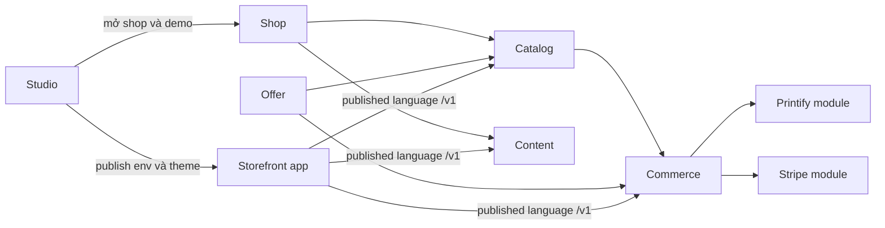

# 05 — Bounded Contexts

Ngày: 2026-10-22. Các context này là ranh giới trong **một** app Rails `builder/`, cộng app `storefront/`. Không đề xuất service mới. Không thiết kế nhà in thứ hai.

Ngôn ngữ: context là cụm việc và dữ liệu một chủ. Module là chỗ code đang nằm. Hai thứ chưa trùng nhau ở chỗ in và thanh toán.

---

## 1. Context map

Storefront là app khác, nói tiếng API `/v1`. Nó không dùng model Platform. Quan hệ đó là conformist: storefront đi theo contract, Platform không đi theo view của một shop.

Studio là upstream của Shop vì `Project#ensure_shop!` tạo shop. Commerce không được gọi studio.

Printify và Stripe đang là module bị Commerce gọi thẳng, chưa phải context có dữ liệu riêng. Đó là chỗ map và mã không khớp.

---

## 2. Shop

**Việc.** Tenant, thành viên, key, cấu hình bán, secret.

**Sở hữu.** `shops`, `shop_memberships`, `shop_api_keys`, `stores`, `business_settings`.

**Bất biến.** Một user nhiều shop qua membership. Một shop một `Store`. Key chọn shop, không nhận `shop_id` từ client làm tenant.

**Ra ngoài.** `GET /v1/shop` (không có secret). Admin `/admin` và `/admin/shops/:subdomain`.

**Phụ thuộc.** Identity (`User`).

**Sự kiện.** Không có bus. Tạo shop có thể xếp `BusinessSyncJob`.

**Nuốt sự kiện.** Không.

**Khi lỗi.** Sync từng phần ghi `business_sync_result`. Secret lỗi không chặn việc tạo shop.

**Ranh giới nên giữ.** `BusinessSetting` là bản của user, không phải của shop. Nguồn lúc bán là `Store`. Lần lưu settings chủ đang ghi đè `Store` (nợ D-02). Context này cần một quy tắc: sync chỉ lúc mở shop, hoặc `Store` luôn thắng sau khi shop đã tự nối.

---

## 3. Studio

**Việc.** Hội thoại, agent, preview, publish ONCE, eval, hạn mức chi phí agent, yêu cầu đổi Platform.

**Sở hữu.** `projects`, `messages`, `agent_commands`, `deployments`, `usages`, `platform_requests`. File storefront nằm ở `projects/` trên đĩa, ngoài schema.

**Bất biến.** Một project một shop sau khi `ensure_shop!`. Ngân sách và số app là của user builder, không của shop.

**Ra ngoài.** UI studio. `Publisher` nói với Docker và ONCE. Agent nói với Claude.

**Phụ thuộc.** Shop (tạo shop, tạo key, đọc theme/form lúc publish).

**Sự kiện.** `AgentCommand` là hàng đợi trong process agent, không phải domain event. `RescueStrandedTurnsJob` là bảo hiểm vận hành.

**Khi lỗi.** Deployment failed giữ site cũ nếu ONCE health check thất bại. Hết ngân sách thì không bắt đầu turn.

**Ranh giới nên giữ.** Studio không ghi đơn, không gọi Printify để in đơn khách. Nó được tạo demo catalog và key. Eval không được đụng shop đang bán của chủ.

---

## 4. Catalog

**Việc.** Sản phẩm, biến thể, bộ sưu tập, trường tùy biến, hàng demo, review đã xuất bản.

**Sở hữu.** `products`, `variants`, `collections`, `collection_products`, `custom_field_definitions`, `product_reviews`, ảnh product.

**Bất biến.** Slug và id Printify unique trong shop. Giá bán nằm trên variant. Review chỉ từ đơn đã ship hoặc delivered và chưa review sản phẩm đó (`Order#reviewable_products`).

**Ra ngoài.** API catalog. Admin sản phẩm.

**Phụ thuộc.** Shop. Import Printify ghi vào các cột Printify của product. Catalog không gọi API Printify lúc khách xem hàng.

**Sự kiện.** Không phát event khi đổi giá. Promotion sửa cột giá trực tiếp.

**Khi lỗi.** Import Printify là job theo shop (`PrintifyImportJob`), kết quả trên `shops.printify_import_result`.

**Ranh giới nên giữ.** `printify_product_id` trên product là chi tiết nhà cung cấp đang nằm trong catalog. Khi có nhà in thứ hai, id đó phải rời sang bảng mapping. Chưa tách lúc chỉ có Printify.

---

## 5. Offer

**Việc.** Mã giảm giá và đợt đổi giá theo lịch.

**Sở hữu.** `discounts`, `promotions`, `promotion_items`.

**Bất biến.** Mã unique không phân biệt hoa thường trong shop. Một variant không nằm trong hai đợt sale chồng giờ. Lượt dùng mã không vượt `usage_limit` nhờ `update_all` có điều kiện.

**Ra ngoài.** API giỏ áp mã. Admin discount và promotion.

**Phụ thuộc.** Catalog (promotion giữ variant và sửa giá). Commerce (checkout đọc mã).

**Sự kiện.** `Promotion::SyncJob` là đồng hồ, không phải event từ catalog.

**Khi lỗi.** Job từng shop. Sale không start nếu status không còn `scheduled`.

**Ranh giới nên giữ.** Offer được sửa giá catalog. Commerce phải copy giá vào line item, không tham chiếu giá sống. Việc đó đã đúng trong `Checkout#place`.

---

## 6. Commerce

**Việc.** Giỏ, quote, đặt đơn, trạng thái đơn, hoàn, nhập kho lại, email đơn.

**Sở hữu.** `carts`, `cart_items`, `orders`, `line_items`, `order_events`. `Checkout` và `OrderLookup` là PORO.

**Bất biến.** Xem `04` mục 7. Thêm: mọi transition đi qua `lock!` và predicate. Event timeline ghi trong cùng transaction với đổi status (`Order#transition!`).

**Ra ngoài.** API giỏ, checkout, đơn, order lookup. Admin đơn.

**Phụ thuộc.** Catalog, Offer, Shop/`Store`. Gọi ra Stripe, Printify, Meta, mailer.

**Sự kiện phát trên `order_events.action`.**

| Action | Ai ghi |
|---|---|
| `placed` | `Checkout#place` |
| `paid`, `in_production`, `shipped`, `delivered`, `cancelled`, `refunded` | `transition!` |
| `edited` | Admin sửa đơn |
| `restocked`, `partially_refunded` | `Order` |
| `recovery_sent` | `Order::ExpireUnpaidCardJob` |
| `sent_to_printify`, `printify_linked`, `printify_shipped`, `printify_cancelled`, `fulfillment_failed` | `Printify::Fulfillment` |

Không có subscriber. Job được gọi trực tiếp (`fulfill_later`, `report_purchase_later`, `deliver_later`). `order_events` là nhật ký cho người, không phải hàng đợi.

**Sự kiện nuốt.** Webhook Stripe và Printify gọi method trên `Order` hoặc `Fulfillment`, sau khi `WebhookEvent.handle` khóa hàng.

**Khi lỗi.** Hết hàng rollback đơn. Lỗi nhà in không rollback đơn paid. Lỗi hoàn Stripe raise trước khi đổi status. Lỗi hủy Printify sau khi đã đổi status thì chỉ ghi event.

**Ranh giới nên giữ.** Commerce sở hữu “khách đã trả chưa” và “đơn đang ở trạng thái nào”. Nó không nên tự biết payload Printify. Hiện nó biết, qua `fulfill_later` và `refund_in_stripe`.

---

## 7. Printify và Stripe, đang nằm trong Commerce

Tách thành context riêng **chưa có trong mã** và **chưa làm ở phase này**. Ghi để không vẽ nhầm.

**Printify đang sở hữu** cột id trên product, variant, order, secret trên `Store`, và PORO `PrintifyGateway`, `Printify::Import`, `Printify::ShippingQuote`, `Printify::Fulfillment`.

**Stripe đang sở hữu** secret và id webhook trên `Store`, id PaymentIntent và tax trên `Order`, PORO `StripeGateway`.

Ngôn ngữ hai bên lộ vào commerce: `printify_order_id`, `stripe_payment_intent_id`, status Printify (`sending-to-production`, `has-issues`, …) chỉ xuất hiện trong `Printify::Fulfillment`, không copy thành enum của `Order`. `Order` chỉ có status thương mại. Đó là chỗ tách đúng duy nhất đã có.

**Hướng khi có nhà in thứ hai, không phải việc kỳ này.** Một module fulfillment nhận “đơn đã paid” và trả “đã nhận in / đã giao / kẹt / chi phí”. Commerce không gọi `PrintifyGateway`.

---

## 8. Content

**Việc.** Trang, menu, form, theme, chính sách.

**Sở hữu.** `pages`, `menus`, `forms`, `form_submissions`, `theme_settings`, bốn cột policy trên `stores`.

**Bất biến.** Slug trang và key menu/form unique trong shop. Publish đọc YAML storefront và ghi schema theme cùng form. File YAML lỗi thì bỏ cả file, dữ liệu shop giữ nguyên (đã chốt trong `docs/platform-v1.md` mục 7; đường publish là `Publisher#apply_theme_files`).

**Ra ngoài.** API pages, menus, policies, form submissions. Admin nội dung.

**Phụ thuộc.** Shop. Studio lúc publish.

**Khi lỗi.** Form submission sai field trả 422 và không ghi. Rate limit riêng.

Content không đọc đơn, trừ việc không cần đọc. Review nằm ở catalog và được commerce kiểm tra quyền ghi.

---

## 9. Storefront

**Việc.** HTML người mua thấy. Theme từng shop.

**Sở hữu.** Không có bảng trên Platform. Code trong repo template `storefront/` và bản copy `projects/<slug>`.

**Bất biến.** Không có database riêng. Không hard-code giá. Key không đặt trong source. Checkout và Payment Element đi qua API.

**Phụ thuộc.** Published language `/v1` qua `storefront_kit`.

**Khi lỗi.** Kit cache catalog vài chục giây. Giỏ, quote, đặt đơn không cache. Platform chết thì trang catalog có thể còn bản cache ngắn. Đặt hàng thì fail.

---

## 10. Integration

**Việc.** Nhận webhook đúng một lần và giữ idempotency của API.

**Sở hữu.** `webhook_events`, `api_idempotency_keys`.

**Bất biến.** Unique `(shop_id, provider, event_id)` và `(shop_id, key)`. Cùng event đang `processed` thì không chạy lại. `failed` thì lần giao sau chạy lại. Event không khớp đơn của shop thì `ignored`.

**Phụ thuộc.** Commerce và module Printify/Stripe để làm việc trong block `handle`.

**Khi lỗi.** Exception ghi `failed` rồi raise để nhà cung cấp gửi lại. Không có hàng dead-letter riêng.

---

## 11. Cái gì cố ý không phải context

| Ý trong prompt gốc | Vì sao chưa lập context |
|---|---|
| Subscription, billing platform, usage commerce | Không có thực thể. `Usage` là tiền agent |
| Market, currency theo cửa hàng ngoài một currency của shop | Shop có một `currency` |
| Artwork, mockup, print area | Không có bảng. Ảnh là attachment. Chữ in là `buyer_inputs` |
| Shipment nhiều kiện | Cột trên `orders` |
| Customer account | Bảng có, luồng không có. Người mua là email trên đơn |
| Analytics | `OrdersSummary` đọc đơn lúc xem dashboard |
| Provider-neutral POD | Một module Printify |

Lập context cho các mục này bây giờ sẽ tạo module rỗng.

---

## 12. Chiều phụ thuộc được phép

Trong app hiện tại, chiều này khớp mã và nên giữ:

1. Storefront chỉ phụ thuộc API.
2. Content và Catalog không phụ thuộc Commerce, ngoại trừ review kiểm tra đơn.
3. Offer sửa giá Catalog. Commerce chỉ đọc và copy.
4. Studio được tạo Shop. Commerce không được tạo Project.
5. Webhook không được đổi shop khác shop của `uid`.
6. Printify và Stripe chỉ được gọi sau khi đơn đã nằm trong database ở trạng thái cho phép (`paid` để in, `pending` thẻ để tạo PaymentIntent).

Chiều đang vi phạm ý 6 ở biên lỗi, không ở lúc gọi: hoàn Stripe có thể xảy ra khi transaction sau đó không commit. Đó là nợ D-01, không phải lý do để tách process.
