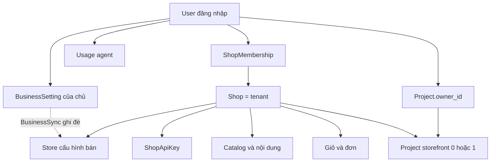

# 06 — Multi-Tenant Architecture

Ngày: 2026-10-22. Thiết kế cho hiện trạng đã chốt: một chủ có nhiều shop, builder nằm cùng platform, shared schema. Không thêm nhà in. Không đổi mã trong phase này.

Tenant là **shop**. User không phải tenant. User là người đăng nhập và có thể thuộc nhiều shop.

---

## 1. Quyết định

Giữ **một database PostgreSQL, một schema, cột `shop_id`, `acts_as_tenant` với `require_tenant`**.

| Phương án | Vì sao không chọn ở giai đoạn này |
|---|---|
| Schema riêng mỗi shop | Mỗi shop một lần migrate. Connection và backup phức tạp hơn trong khi mới một chủ, số shop bằng số storefront |
| Database riêng mỗi shop | Đúng với app cũ đã bỏ (`docs/platform-v1.md` mục 10). Dashboard gộp nhiều shop và webhook một chỗ sẽ phải nối nhiều database |
| Hybrid (shop lớn tách DB) | Chưa có shop nào cần cô lập vật lý. Thêm nhánh vận hành trước khi có số liệu |

Shared schema đã khớp mã: foreign key `shop_id`, unique kèm shop, job mang `shop_id`, API và admin không nhận tenant từ tham số tự do.

Đổi sang schema riêng sau này là di chuyển lớn (mỗi bảng, mỗi job, Active Storage, backup). Không có đường tắt. Làm khi một shop cần khôi phục hoặc đặt máy riêng, không làm vì lý thuyết.

---

## 2. Cây sở hữu

Một chủ nhìn mọi shop của mình ở `/admin`. Số liệu từng shop được đọc trong tenant của shop đó (`Admin::DashboardsController` bọc `OrdersSummary` bằng `with_tenant`). Không có bảng doanh thu gộp. Gộp là cộng các lần đọc đã vào đúng shop.

Staff một shop không thấy shop khác: `ShopAdmin::BaseController#set_shop` tìm membership theo subdomain. Không có membership thì 404.

---

## 3. Việc nhiều shop phải làm được

| Việc | Trong mã | Ghi chú |
|---|---|---|
| Nhiều shop cho một user | VERIFIED | `Shop.open!`, membership |
| Subdomain riêng | VERIFIED | `shops.subdomain` unique, publish `subdomain.PUBLISH_DOMAIN` |
| Domain riêng | MISSING | Chỉ subdomain ONCE |
| Theme riêng | VERIFIED | `theme_settings` một hàng mỗi shop |
| Catalog riêng | VERIFIED | `shop_id` trên product |
| Giá riêng | VERIFIED | Giá trên variant của shop. Không có bảng giá dùng chung |
| Đơn và khách riêng | VERIFIED | Email khách unique theo shop. Order lookup nhét `shop_id` vào token |
| Stripe và Printify riêng trên `Store` | VERIFIED trên bảng | Lần lưu settings chủ ghi đè mọi shop user admin. Nợ D-02 |
| Một tài khoản Printify cho nhiều shop | VERIFIED | `external_id` = `uid` + số đơn |
| Analytics gộp | PARTIAL | Dashboard đọc từng shop rồi xếp cạnh nhau. Không có sổ cái chung |
| Hạn mức đơn theo shop | MISSING | Hạn mức đang có là số app và USD agent theo user |

Domain riêng và hạn mức đơn không chặn mô hình hiện tại. Ghi đè secret thì chặn, nếu hai shop cần hai tài khoản Stripe.

---

## 4. Tenant được gắn ở đâu

Ba cửa vào, cả ba đều tự tìm shop rồi mới `set_current_tenant`. Không cửa nào lấy `shop_id` từ JSON của khách làm tenant.

| Cửa | Cách chọn shop | File |
|---|---|---|
| Admin shop | Membership của user đăng nhập, khớp subdomain trên URL | `ShopAdmin::BaseController#set_shop` |
| Storefront API | Bearer token → digest → `ShopApiKey` → shop của key | `StorefrontApi::V1::BaseController#authenticate_key` |
| Webhook | `shops.uid` trên path, rồi chữ ký bằng secret của shop đó | `Webhooks::BaseController#set_shop` |
| Job có `shop_id` | Serialize lúc enqueue, `with_tenant` trước `perform` | `ApplicationJob` |
| Job mọi shop | `Shop.each_in_turn` | `Shop`, các job trong `recurring.yml` |
| Dashboard chủ | Từng shop một, trong `with_tenant` | `Admin::DashboardsController` |

`Shop`, `User`, `Project`, `Session`, `BusinessSetting`, `Usage` không `acts_as_tenant`. Chúng là dữ liệu platform. Vào hàng của shop từ các model đó phải bọc tenant, như dashboard và `Project#ensure_shop!` đã làm.

---

## 5. Ranh giới studio và shop

Builder admin (`users.role` admin hoặc owner) thấy mọi project. Member chỉ thấy project mình sở hữu. Quyền này không cấp membership shop.

Hệ quả chấp nhận được khi một người vận hành platform. Nếu sau này có chủ thứ hai là `member`, họ không thấy project của nhau. Họ cũng không thấy đơn của nhau, vì đơn đi qua membership.

Builder admin thấy mã storefront của chủ khác nếu những người đó cùng một cài đặt platform. Key shop nằm trong cột mã hóa trên `projects`. Phase bảo mật phải kiểm tra màn download có trả key hay không. Chưa kết luận ở đây.

Giới hạn hai app mỗi member không giới hạn số shop tạo từ `/admin`. Shop tạo từ admin không có project. Hai đường này cần một quy ước sản phẩm trước khi coi là lỗ cô lập. Đó là nợ D-10, không phải lộ dữ liệu.

---

## 6. Đường lớn hơn sau này

Thứ tự nếu cô lập phải chặt hơn, từng bước, không nhảy cóc:

1. Giữ shared schema. Thêm RLS chỉ khi có test chứng minh mọi bảng tenant đã có policy và role ứng dụng không phải superuser. Làm sớm hơn sẽ vỡ job và `without_tenant` hợp lệ.
2. Prefix object storage theo `shop.uid` khi chuyển khỏi disk local.
3. Tách database của một shop chỉ khi shop đó cần khôi phục riêng hoặc hợp đồng yêu cầu. Ứng dụng lúc đó cần một registry shop → database. Không thiết kế registry bây giờ.

Không có việc migrate dữ liệu ở phase này. Schema hiện tại đã là mô hình đích cho giai đoạn một chủ nhiều shop.
