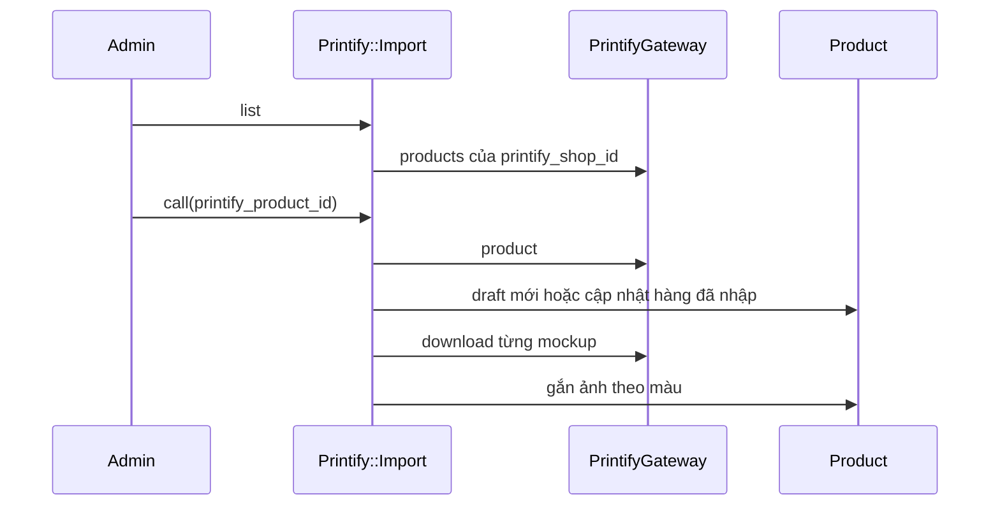
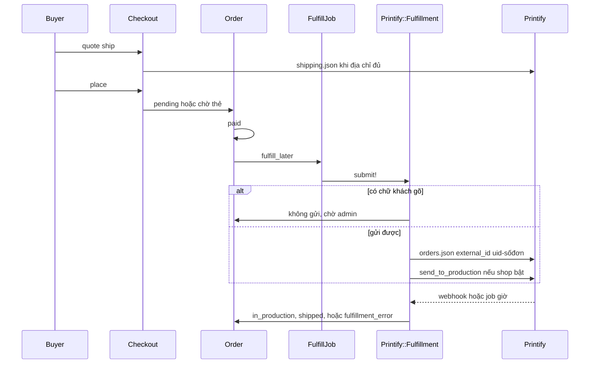

# 10 — POD Integration Architecture

Ngày: 2026-10-22. Mô tả nhà in đang chạy và ranh giới nên giữ khi có nhà in thứ hai. Printful và Gelato không có trong repo. Không sửa mã trong phase này.

Nhà in duy nhất là Printify. Code nằm ở `PrintifyGateway`, `Printify::Import`, `Printify::ShippingQuote`, `Printify::Fulfillment`, secret trên `stores`.

---

## 1. Kết luận

Commerce đã có một đường in khép kín cho Printify. Đường đó biết payload Printify. `Order` gọi `Printify::Fulfillment` trực tiếp.

Chưa xây adapter, chưa thêm class rỗng cho nhà in khác. Adapter trong `11` là hợp đồng cho lần có nhà in thứ hai thật. Lần sửa mã đầu tiên, khi được duyệt, chỉ bọc Printify sau hợp đồng đó. `Order` hết gọi gateway.

Đến lúc đó vẫn một kết nối in trên mỗi shop, chủ chọn. Không có bộ chọn nhà in tự động.

---

## 2. Những gì Printify đang làm

| Việc | Có trong mã | Chỗ |
|---|---|---|
| Nối token, chọn shop Printify | Có | `Store#connect_printify!` |
| Liệt kê sản phẩm đã thiết kế trên Printify | Có | `Printify::Import#list` |
| Kéo option, variant, giá, cost, mockup có sẵn | Có | `Printify::Import#call` |
| Tạo sản phẩm trắng hoặc upload artwork lên Printify | Không | Gateway không có method này |
| Báo giá ship | Có | `Printify::ShippingQuote` |
| Gửi đơn sau khi đã paid | Có | `Printify::Fulfillment#submit!` |
| Gửi chữ khách gõ lên áo | Không | `needs_personalizing?` chặn gửi tự động |
| Hủy đơn bên Printify | Có, Printify có thể từ chối | `cancel_order` |
| Lấy trạng thái và tracking | Có | `sync!`, webhook, job mỗi giờ |
| Kiểm chữ ký webhook | Có | `PrintifyGateway.valid_signature?` |

Sản phẩm trên Printify được làm ở giao diện Printify. Platform nhập bản đã có. Mockup là ảnh Printify đã render, `PrintifyGateway#download` tải về Active Storage. Platform không gọi API sinh mockup.

---

## 3. Luồng nhập hàng

Hàng mới vào là `draft`. Lần cập nhật giữ title, mô tả và giá chủ đã sửa. Cost, variant còn bán và variant mới lấy từ Printify. **VERIFIED** (comment và `call` trong `printify/import.rb`).

Option lấy tối đa ba, Color đứng trước nếu có. Variant Printify không bán thì variant local không còn `available`. Ảnh tối đa 12.

Id Printify nằm trên `products.printify_product_id` và `variants.printify_variant_id`. Không có bảng mapping. Một sản phẩm platform một id Printify.

---

## 4. Luồng đơn

Điều kiện gửi: shop đã nối Printify, đơn không `test`, còn `paid`, chưa có `printify_order_id`, line item có cả product id và variant id Printify.

`external_id` là `shop.uid` cộng số đơn. Nhiều shop platform được trỏ vào một shop Printify. Printify báo đơn đã tồn tại thì mã tìm trong ba trang đơn gần nhất.

Đơn có `properties` không tự gửi. Admin gửi bằng `personalized: false` hoặc dán id đơn tạo tay (`link!`). Chữ khách không có trong payload (`fulfillment.rb` `payload` chỉ có product id, variant id, quantity).

Sau khi gửi, webhook `order:shipment:created`, `order:shipment:delivered`, `order:updated` chỉ nói đơn nào đổi. Platform gọi `order` trên Printify rồi mới đổi status. Webhook giả không tự ghi tracking. **VERIFIED** (`Webhooks::PrintifyController`).

Job `Order::TrackShipmentsJob` làm cùng việc mỗi giờ cho đơn đã có `printify_order_id`. Đơn `paid` mà gửi lỗi không nằm trong job đó.

---

## 5. Trạng thái

`Order` giữ trạng thái thương mại. Trạng thái Printify không được lưu thành cột riêng. `sync!` map như sau.

| Printify | Order |
|---|---|
| `sending-to-production`, `in-production`, `partially-fulfilled`, `fulfilled` khi chưa ship hết | `in_production` nếu đang `paid` |
| `fulfilled` và có shipment, đơn chỉ toàn hàng Printify | `shipped`, tracking gộp một chuỗi |
| `fulfilled` nhưng đơn còn hàng shop tự gửi | event `printify_shipped`, status không thành `shipped` |
| mọi shipment có `delivered_at` | `delivered` nếu đang `shipped` |
| `canceled` | không đổi status, ghi `fulfillment_error` |
| `has-issues`, `unfulfillable`, `payment-not-received` | ghi `fulfillment_error` |

`printify_send_to_production` tắt thì đơn Printify ở on-hold và order platform ở `paid` cho đến khi Printify báo đang in.

Nhà in sau này phải map về cùng các hiệu ứng đó. Không thêm status Printful vào enum `Order`.

---

## 6. Khi nhà in lỗi

Đơn đã paid vẫn còn. `submit!` ghi `fulfillment_error` và nuốt `PrintifyGateway::Error`. Job Solid Queue vẫn xanh. Admin gửi lại từ `ShopAdmin::Orders::FulfillmentsController`.

Hủy đơn local gọi hủy Printify sau khi đã refund. Printify từ chối thì đơn local đã hủy, cột lỗi ghi `fulfillment_failed`. Không có hàng đợi riêng cho ca này.

Quote ship lỗi trả nil. Checkout dùng giá flat và vẫn đặt (nợ D-03).

Gateway có timeout 10 giây mở nối, 30 giây đọc. Lỗi 429 thành message “thử lại sau một phút”. Không có backoff trong job. Không có circuit breaker. Với một nhà in và đơn do người gửi lại, chưa cần circuit breaker.

---

## 7. Định tuyến

Hiện tại thủ công và cố định: một `printify_shop_id` trên `Store`. Mọi line item có id Printify đi shop đó. Hàng không có id ở lại cho nhân viên.

Chưa có định tuyến theo nước in, giá, hay độ tin cậy. Không thêm khi chỉ có một kết nối.

Khi có nhà in thứ hai, bước đầu vẫn là chủ gán từng sản phẩm cho một kết nối. Bộ luật tự chọn nhà in để sau, khi có hai giá ship thật để so.

---

## 8. Việc cố ý chưa làm

| Việc | Lý do để ngoài kỳ này |
|---|---|
| Upload artwork, sinh mockup, catalog áo trắng | Platform không làm thay giao diện Printify |
| In chữ khách gõ | Printify không nhận text trên sản phẩm có sẵn. Cần file in riêng |
| Bảng shipment nhiều kiện | Một chuỗi tracking đang đủ cho một nhà in |
| Printful, Gelato | Không có tài khoản và không có mã |
| Tách process fulfillment | Cùng app Rails |

Lần sửa mã được duyệt sau tài liệu này chỉ được bọc các class Printify hiện có. Không được thêm nhà in giả.
