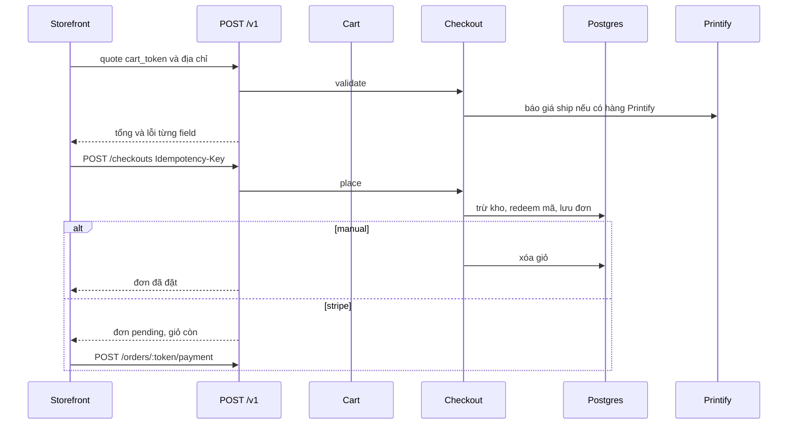

# 12 — Checkout Architecture

Ngày: 2026-10-22. Luồng đặt hàng đang chạy trong `Checkout` và `POST /v1/checkouts`. Không sửa mã.

Checkout không có bảng. Giỏ là `carts`. Đơn xuất hiện ở `place`. Đơn thẻ chưa trả vẫn là một `orders` ở `pending`.

---

## 1. Các bước

`quote` không tạo đơn. `create` gọi `Checkout#place`. Cả hai dùng cùng field địa chỉ (`StorefrontApi::V1::CheckoutsController::FIELDS`).

---

## 2. Giá

`place` copy `variant.price_cents`, title và SKU vào line item. Giá trong JSON của client không được đọc.

Tổng trước thuế:

`subtotal − discount + shipping`

Thuế không có trong tổng này. Thuế cộng ở lần tạo PaymentIntent (`13`). Quote và đơn manual vì thế không có thuế.

Ship:

- Hết hàng, mã free ship, hoặc subtotal đạt ngưỡng của shop: 0.
- Có hàng Printify và Printify trả được giá: giá đó cộng flat cho phần hàng không phải Printify.
- Printify không trả được giá: flat cho cả giỏ. Đơn vẫn tạo. Nợ D-03.

Flat là giá món đầu cộng giá món sau trên `Store`. Ngưỡng free ship nhìn subtotal hàng, không nhìn riêng phần Printify. Khi free ship, shop vẫn trả Printify. Comment trong `Checkout#shipping_cents` nói rõ điều đó.

Quote ship cache 30 phút trên Platform. Key không có id shop platform. Hai shop chung một shop Printify dùng chung cache. Cùng hàng và cùng địa chỉ thì cùng giá.

---

## 3. Kiểm tra trước khi ghi

`Checkout#valid?` kiểm tra:

- Có dòng `buyable` (variant đang bán, product active, còn kho nếu có track).
- Email, tên, địa chỉ, thành phố, quốc gia. Quốc gia phải thuộc danh sách shop ship.
- Mỹ, Canada, Úc bắt buộc vùng và mã bưu chính. Vùng gõ chữ được đổi thành mã.
- Đơn có hàng Printify thì bắt buộc điện thoại.
- `buyer_inputs` trên giỏ vẫn khớp câu hỏi hiện tại của sản phẩm.
- `payment_method` thuộc `Store#payment_methods`.

`payment_methods` là `stripe` khi có cả secret và publishable key, rồi `manual` nếu shop bật hoặc nếu không còn cách nào khác. Danh sách không bao giờ rỗng. Cách đầu tiên được chọn khi client không gửi hoặc gửi sai.

---

## 4. Transaction của `place`

Trong một transaction:

1. `Variant#take_stock` trừ kho bằng một `update_all` chỉ chạy khi `inventory_quantity` đủ. Variant không track thì bỏ qua.
2. `Discount#redeem!` tăng `times_used` nếu chưa chạm hạn.
3. `order.save!` và event `placed`.
4. Đơn manual xóa dòng giỏ và mã trên giỏ. Đơn thẻ giữ giỏ đến lúc Stripe báo đã trả.

Hết hàng hoặc mã hết lượt thì `rollback` cả khối. Hai người không cùng lấy chiếc cuối nếu kho đang track.

Số đơn là max trong shop cộng một, sàn 1001. Unique `(shop_id, number)`. Trùng thì thử lại tối đa ba lần.

Sau commit, đơn manual mới gửi mail khách, mail admin và job Meta. Đơn thẻ chưa gửi những thứ đó. Gửi nằm ở `confirm_card_payment!`.

---

## 5. Idempotency

Header `Idempotency-Key` trên `POST /v1/checkouts`. Cùng key và cùng body trả lại đơn đầu, header `Idempotent-Replayed`. Cùng key khác body thì 422. Key đang xử lý thì 409.

Không có header thì hai POST tạo hai đơn. Storefront gửi key (`storefront_kit` `place_order`). Client khác có thể không gửi.

Key chưa có response mà process chết thì lần sau trong vòng một ngày nhận 409. `Cart::CleanupJob` xóa key cũ hơn một ngày. Nợ D-09.

Kho đã trừ trong request đầu vẫn trừ nếu request đó commit rồi chết trước khi lưu response. Lần replay sau một ngày có thể tạo đơn thứ hai. Cửa này hẹp. Khóa đúng hơn là từ chối đặt lại cùng giỏ khi giỏ đã có đơn thẻ `pending`. Mã chưa làm vậy.

---

## 6. Giỏ và kho trong lúc chờ trả thẻ

Đơn thẻ `pending` giữ kho đến một ngày (`Order::UNPAID_CARD_RECOVERY`). Sau một giờ, job gửi một mail nhắc nếu Stripe chưa `succeeded` và không còn `processing`. Sau một ngày, job `cancel!` không gửi mail hủy, trả kho và trả lượt mã.

Trước khi hủy, job gọi `sync_card_payment!`. Khách trả muộn thì đơn thành `paid` thay vì bị hủy.

Đơn manual trừ kho ngay lúc đặt và không đi qua job này.

---

## 7. Đơn test

Key `preview` đặt `checkout.test`. Đơn `test` không gửi Printify, không báo Meta, không vào `Order.real`. Thanh toán preview chỉ chạy khi Stripe của shop đang ở test mode. Sai thì API `test_mode_unavailable`.

---

## 8. Không nằm trong checkout

- Thuế và PaymentIntent. Xem `13`.
- Gửi Printify. Chỉ sau `paid`.
- Tài khoản khách. `customer` trên checkout không được API gán.
- Sửa giá sau khi line item đã ghi. Đơn giữ giá lúc đặt.
