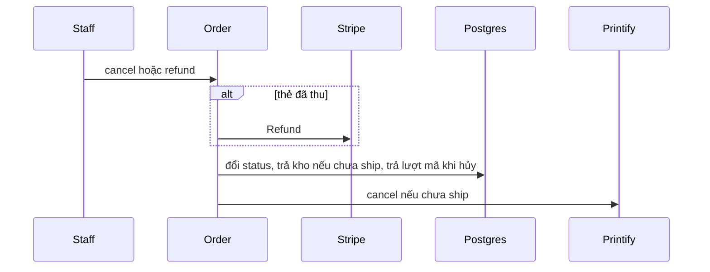

# 13 — Payment Architecture

Ngày: 2026-10-22. Tiền của một shop đang chạy qua Stripe Payment Element hoặc đánh dấu tay. Không lưu số thẻ. Không sửa mã.

Một shop một cặp khóa Stripe trên `stores`, mã hóa. Không có Stripe Connect, không có bảng `payments`. Trạng thái tiền nằm trên `orders`.

---

## 1. Hai đường

| | Manual | Stripe |
|---|---|---|
| Lúc `place` | Đơn `pending`, giỏ xóa, mail xác nhận | Đơn `pending`, giỏ giữ, chưa mail |
| Ai xác nhận đã trả | Nhân viên `mark_paid!` | `confirm_card_payment!` khi PaymentIntent `succeeded` |
| Vào hàng cần xử lý | Có, vì đang chờ tiền mặt | Không, cho đến khi paid hoặc bị hủy |
| In Printify | Sau `mark_paid!` | Sau `confirm_card_payment!` |
| Hoàn khi hủy lúc còn `paid` | Không gọi Stripe | `StripeGateway#refund` trước transaction local |

`mark_paid!` từ chối đơn thẻ. Thẻ không được người đánh dấu đã trả.

---

## 2. PaymentIntent

`POST /v1/orders/:token/payment` gọi `Order#card_payment!` khi đơn còn `pending` và `payment_method` là stripe.

Trong `with_lock`:

1. Đã có `stripe_payment_intent_id` thì lấy lại intent đó.
2. Shop bật `stripe_tax` thì tạo Stripe Tax Calculation và ghi `tax_cents`, `stripe_tax_calculation_id`, cộng thuế vào `total_cents`.
3. `PaymentIntent.create` với số tiền đã gồm thuế, metadata `order_id`, `order_number`, `shop` = `uid`.
4. Khóa idempotency phía Stripe là `order-{uid}-{id}`. Gọi lại sau khi DB rollback vẫn nhận cùng intent.

API trả `client_secret`, publishable key, `amount_cents`, `tax_cents`. Storefront dùng Payment Element. Số thẻ vào Stripe, không vào Platform và không vào storefront.

`amount` đổi sang đơn vị Stripe. VND không có phần xu nên cent của shop chia 100 (`StripeGateway::ZERO_DECIMAL`).

Tiền trong quote có thể nhỏ hơn tiền trong Payment Element khi thuế bật. Đó là nợ D-04. Khách xác nhận tổng checkout trước khi thấy thuế.

Ghi transaction thuế (`record_tax`) chạy sau khi đã paid. Lỗi thì chỉ log. Đơn vẫn paid.

---

## 3. Xác nhận đã trả

Hai cửa, cửa nào tới trước thì thắng:

- Khách mở lại trang đơn. Storefront hỏi Platform, Platform gọi `sync_card_payment!`.
- Webhook `payment_intent.succeeded` tại `/webhooks/stripe/:uid`.

`confirm_card_payment!` chỉ chạy khi còn `pending` và là thẻ. `transition!` khóa hàng. Cửa thứ hai nhận `InvalidTransition` và trả false. Rồi mới xóa giỏ, ghi thuế, gửi mail, báo Meta, `fulfill_later`.

Webhook tìm đơn bằng `stripe_payment_intent_id`. Chưa kịp lưu id thì chỉ nhận nếu metadata `shop` khớp `uid` và đơn thẻ chưa có intent. Id đơn số không đủ, vì mỗi shop đếm từ 1001.

`payment_intent.payment_failed` không hủy đơn. Khách trả lại trên cùng intent.

`charge.refunded` đủ cả tổng thì `refund!` với `stripe: false` vì Stripe đã hoàn. Hoàn một phần chỉ ghi `refunded_cents` và timeline, không đổi status.

Chữ ký webhook sai thì 400, không đổi đơn. Event trùng theo `(shop, stripe, event_id)`.

---

## 4. Hủy và hoàn

Stripe được gọi trước transaction. Printify được gọi sau. Một trong hai thất bại thì tiền và lệnh in không cùng trạng thái. Nợ D-01.

`refund!` khi đã `shipped_at` không trả kho. `return_to_stock!` là nút riêng sau khi hàng về.

Hủy đơn thẻ chưa thu không gọi Stripe. PaymentIntent cũ hết hạn phía Stripe. Kho được trả trong `cancel!`.

Job đơn thẻ quá hạn cũng gọi `cancel!`. Nếu Stripe đã thu mà webhook chưa tới, `sync_card_payment!` xác nhận paid và không hủy.

---

## 5. Phạm vi PCI

Platform tạo PaymentIntent và nhận webhook. Không có field số thẻ, không có form thẻ tự viết. Publishable key và `client_secret` ra storefront để Payment Element chạy.

Phạm vi chứng nhận nằm ở Stripe chừng nào log không lưu body PaymentIntent và không có ai dán số thẻ vào ghi chú đơn. `filter_parameters` đã lọc tham số có chữ `secret`. Đây là mô tả kiến trúc, không phải kết luận đã đạt một mức SAQ.

Khóa secret Stripe nằm trên `stores`, mã hóa bằng khóa suy ra từ `secret_key_base`. Đổi `secret_key_base` làm không đọc được khóa. Nợ D-18.

---

## 6. Đối soát

Chưa có sổ thanh toán riêng. Đối soát một đơn là đọc:

- `payment_reference` và `stripe_payment_intent_id`
- `total_cents`, `tax_cents`, `refunded_cents`, `paid_at`, `refunded_at`
- `webhook_events` của shop
- `fulfillment_cost_cents` khi Printify đã trả cost

`margin_cents` trừ thuế, hoàn và cost in. Chưa trừ phí Stripe. Phí đó chỉ có trên dashboard Stripe.

Không có job kéo phí hay so PaymentIntent với đơn mỗi đêm. Webhook cộng lần khách mở trang đơn là hai cửa xác nhận. Đơn `processing` (ghi nợ ngân hàng) được job hết hạn bỏ qua, không hủy.

---

## 7. Giữ khi sửa

- Một PaymentIntent cho một đơn, khóa `order-{uid}-{id}`.
- Metadata `shop` bằng `uid`.
- Không đánh dấu tay đơn thẻ.
- Không hoàn tiền bên trong adapter Printify.
- Thuế phải xuất hiện ở quote trước khi khách xác nhận, nếu D-04 được sửa. Không cộng thuế thêm lần nữa trên intent đã tạo.
